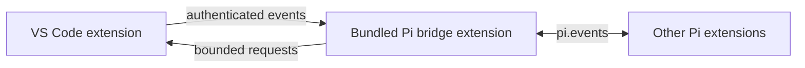

# Pi for VS Code

Use your existing [Pi](https://pi.dev) providers, models, and tools in VS Code. Work in a persistent sidebar or native `@pi` chat, attach editor context, and preview proposed edits before applying them.

[Install](#install) · [Get started](#get-started) · [Workflows](#focused-workflows) · [Settings](#settings) · [Security](#security-and-limits) · [Development](#development)

## Highlights

- **Rich responses** — Read Markdown tables, task lists, highlighted code, LaTeX math, and Mermaid flowcharts or sequence diagrams in the panel. Rendering uses bundled assets without a CDN.
- **Persistent sessions** — Browse, search, and switch recent workspace sessions, then rename, compact, export, delete, or hand them off to a terminal.
- **Editor-aware context** — Attach selections, files, diagnostics, language-provider definitions/references/call hierarchy/symbols, terminal text, and images. Inspect, redact, refresh, or pin a snapshot before sending it.
- **Review-first edits** — Preview a complete proposal or selected hunks, then apply the reviewed result with one workspace edit.
- **Focused workflows** — Review Git changes in four scopes, repair workspace diagnostics across files, import isolated worktree results, repair failed tests, restore request checkpoints, and inspect paused Node.js debug values.
- **Pi ecosystem support** — Keep using your Pi providers, models, thinking levels, prompt templates, skills, extensions, and contributed tools.
- **VS Code integration** — Fix diagnostics, rewrite selections, generate tests, request inline completions, and predict the next edit.

See the [feature matrix](docs/FEATURE_MATRIX.md) for the complete capability map and [Pi terminology](docs/PI_TERMINOLOGY.md) for the core/extension naming boundary.

## Requirements

- VS Code 1.140 or newer
- [Pi](https://pi.dev), installed and authenticated

Confirm that Pi is available in the environment where VS Code runs the extension:

```bash
pi --version
```

### Windows process launches

Windows supports native `.exe` files and the standard npm `cmd-shim` Node template without custom shebang arguments or environment assignments. The extension resolves that template to its JavaScript entry point and starts `node.exe` directly, without a command shell. Node must be beside the shim or in the child PATH; the VS Code executable is not used as Node. Custom `.cmd`/`.bat` wrappers are rejected with a launch error. Use a native executable or reinstall Pi with npm when a wrapper is unsupported. This restriction does not change an explicit terminal handoff.

Executable lookup uses the final child environment. Windows environment keys are case-insensitive; PATH overrides and removals apply before lookup. Bare names search nonempty PATH entries in directory order, preferring `.exe`, then `.cmd`, then `.bat` in each directory. Quoted PATH directories are supported; relative entries use the child working directory. Missing or empty PATH does not search the parent PATH, system directories, or the workspace implicitly. Explicit directory-qualified paths use the workspace launch directory. Drive-relative paths such as `C:pi.cmd` and rooted paths without a drive are rejected, including in PATH entries. Quoted empty PATH entries are ignored.

Stopping or cancelling targets the actual runtime, not a shell. Cleanup has bounded exit and pipe deadlines. Windows reports that descendant cleanup is unverified; a root-process exit is not proof that every tool or detached descendant stopped. Foreground cleanup warnings remain available through session deletion and failed startup cleanup. Check remaining work before starting conflicting operations.

## Install

If you have `narumi.pi-coding-agent-vscode` installed, follow [Upgrade from the old extension ID](#upgrade-from-the-old-extension-id) first.

Ensure that `curl`, a POSIX shell, and the VS Code `code` command are available. Then install the latest release:

```bash
curl -fsSL https://raw.githubusercontent.com/narumiruna/pi-vscode/main/scripts/install.sh -o install-pi-vscode.sh &&
sh install-pi-vscode.sh &&
rm install-pi-vscode.sh
```

Review [`scripts/install.sh`](scripts/install.sh) before running downloaded code. The command stops if the download fails. The installer downloads `pi.vsix`, installs it with `code --install-extension`, and removes only the legacy global bridge files created by older releases. Extension activation performs the same cleanup for direct VSIX and Marketplace upgrades before starting Pi. New installations do not create files under `~/.pi/agent`.

For manual installation, download `pi.vsix` from [GitHub Releases](https://github.com/narumiruna/pi-vscode/releases) and use **Extensions: Install from VSIX…**.

To install a specific version, pass it to the downloaded script, for example `sh install-pi-vscode.sh 0.0.2`.

After installation or an update, run **Developer: Reload Window**. Sidebar sessions and **More… → Open in Terminal** load the bundled bridge automatically. See [Extension bridge](#extension-bridge) to use its tools in an ordinary integrated terminal.

## Get started

1. Run **Pi: Open Sessions** from the Command Palette, or open **Pi** in the Secondary Sidebar. Choose a session from **Sessions**, or use **View all** to search the current workspace. Sending from the Sessions-level composer starts a new session; **Back to Sessions** returns there from a conversation.
2. Choose the **Attach** icon to add code, files, or images, or paste a supported image with Ctrl/Cmd+V.
3. Enter a request. One composer button shows the active model and thinking level. Open it to choose **Change Model** or **Change Thinking Level**. Open **More… → Conversation details → Submission help** for shortcuts.
4. For proposed changes, choose **Preview**, optionally select hunks, and then choose **Apply**.
5. Open **More…** for session management, export, terminal handoff, staged review, repair tools, checkpoints, and background or worktree agents. Open **More… → Conversation details → Session details** to select and copy the full session ID and inspect context usage.

Use `@pi` in VS Code's native Chat view when you prefer the native participant workflow. Native Chat history is separate from the Pi sidebar session.

### Conversation controls

- One primary status area stays inside the composer, directly above the composer box and outside the transcript and workflow scrollers. Its location is the same in Sessions and conversations. Idle reserves one line without Ready text or a dot; single-line progress does not move the composer box. Long actionable text and recovery buttons can wrap and increase its height.
- Status priority is problems, submission blockers, progress, non-Ready results, then quiet idle. Empty input is neutral: its disabled-send explanation uses only an accessible description and tooltip, never a visible hint or a replacement for progress. The host still validates every request.
- Stop remains in the composer actions. Reconnect, Retry, and Refresh history stay in the status area with unchanged host availability checks. Blocking errors and cleanup warnings retain their separate non-dismissible notice and diagnostic action; tool output, background cards, and extension widgets keep their placements.
- **More… → Conversation details** contains submission help, file-completion instructions, text draft recovery, session ID, context usage, and extension status. Close or Escape returns focus to More. Read-only details remain available during work or disconnect; mutation controls retain their host checks.
- Scroll up without following new output. **Jump to latest** returns to current output and restores automatic following; **New output** indicates a transcript change, not a status update.
- **More… → Word wrap**, in **Conversation display**, shows On/Off and wraps long code lines for display only. It starts Off and is local to the view, not a saved setting. Source text, copied text, shell cards, and editor files are unchanged.
- The header's **Find text** magnifying-glass icon opens literal, case-sensitive search in the current history window, including code and diagram source. The scope explanation appears only inside the expanded search bar. Search excludes thinking, tool details, and images. Use **Previous/Next** or Enter/Shift+Enter; Escape closes search and returns focus to the icon.
- The header's **Earlier history** clock icon replaces the bounded window; its **Latest history** down-to-line icon returns to the current tail and is disabled when that window is already latest. Loading, failures, earlier-window position and truncation remain visible when relevant, even with search closed. Each window contains at most 100 messages and 250,000 text characters. Omitted portions of long messages are labelled and cannot be browsed. History responses above the existing 5 MiB RPC limit remain unavailable; this is not whole-session search.
- The input's accessible description and **Submission help** distinguish `@` snapshot attachment from Tab path-only insertion. Message headings support assistive-technology navigation. Earlier Orca evidence applies to the previous layout; screen-reader behavior for this relocation requires a separate check.
- **More…** has one searchable native picker with **Session management**, **Conversation display**, **Review and repair**, **Background work**, and **Pi configuration** groups. Existing action names and commands remain available.

#### Text draft recovery

Open **More… → Conversation details → Text draft recovery → Enable recovery** to review and accept draft retention before saving any composer text. This is for non-secret text only. The extension uses workspace-scoped VS Code `workspaceState`, without Settings Sync: at most 50,000 characters per draft, 20 drafts, and 250,000 total characters. Recovery expires after seven days; expired records are removed on the next activation or access. On checked Linux desktop builds, drafts reside in the local profile's workspace database. With the checked VS Code Server web clients, they reside in the browser's IndexedDB workspace storage, even though the extension runs in a remote Node Extension Host. Other remote client layouts remain unverified. Remote draft updates still pass through the workspace Extension Host over VS Code's connection; client-side storage does not mean the text never reaches that host. These updates are not model/provider requests. VS Code manages backups; removal is not secure erasure.

A short **Retained text available · Review** notice appears only when a draft is available for the current scope. It opens recovery controls, not the retained text itself. **Restore text** requires an empty composer and never sends, queues, or executes the text. Attachments, pins, image bytes, extension dialogs, and queued-message recovery payloads are not saved. **Discard retained text** removes the current record; **Disable and discard all** removes the extension's draft store and disables retention. Removal is not secure erasure of backups. Recent edits can be lost before storage completes. A session change preserves newer text rather than silently assigning it to another session; verify the session and clear that kept text before sending again.

See [Composer behavior and validation](docs/COMPOSER_UX.md) for state priorities, history bounds, and validation limits.

### Pi extension dialogs

Pi extensions can request single-line input or a native multiline editor through the public RPC UI protocol (reference: Pi 1.3.0). No model request is needed to display a dialog.

Before each multiline editor opens, accept **Open Non-Secret Editor** or press Escape to cancel. VS Code can retain untitled text in hot-exit backups. Do not enter credentials. Use **Pi: Submit Extension Editor** or Ctrl/Cmd+Enter to return the full current text, including an empty value. Use **Pi: Cancel Extension Editor**, Ctrl/Cmd+Escape, or close the document to cancel without returning a partial value. Actions appear only for the owned active editor. **Save does not submit** and can prompt for a file path. On cleanup, choose **Don't Save** to discard the text; cancelling that close leaves an inactive document that you must close yourself.

Only one multiline editor request can be active at a time. Prefill and returned text are limited to 100,000 characters. Text uses VS Code's document line endings; mixed line endings can be normalized. Timeouts close the owned UI locally, while Pi supplies its own timeout default. Replies cannot move to a replacement session or process.

Untimed confirmations keep the native permission modal. Timed confirmations default to **Block**. **Review Full Message** opens the complete bounded Unicode/multiline message in a read-only, memory-only document. Only that active review enables **Pi: Allow Reviewed Extension Action** and **Pi: Block Reviewed Extension Action**. Closing the review blocks the action; timeout removes the review and disables its actions.

### Editor actions

The Pi button in the editor title opens Sessions and uses separate light and dark icons to stay visible in both themes.

| Action | Shortcut or location |
| --- | --- |
| Fix a diagnostic or open inline edit | **Ctrl/Cmd+I** |
| Request an inline completion | **Alt+]** |
| Suggest the next edit | **Ctrl+Alt+N** / **Cmd+Alt+N** on macOS |
| Ask about or modify a selection | Editor lightbulb → **Rewrite**, or editor context menu → **Pi** |

**Ask About Selection** opens the active conversation and shows your question and Pi's response, including when the sidebar opens for the first time. It does not create a replacement session.

Automatic inline completions are disabled by default. Enable `pi.inlineCompletions.enabled` to request them after a typing pause.

### Temporary passage annotations

The foreground sidebar agent can use `vscode_annotate` to highlight whole-line passages in already-open code or text documents and attach a labelled, plain-text hover explanation. This does not write files, open tabs, move the cursor, scroll, or change focus. Inactive open tabs show their annotations when you return to them. Cached documents with no open text or diff tab are not eligible.

Each call replaces the annotations for one file; an empty annotation list clears that file. The agent must supply the exact current lines. Stale text, invalid ranges and unsafe paths are rejected without replacing existing annotations. Use **Pi: Clear Annotations** to remove all annotations locally, even when Pi is disconnected.

Annotations are memory-only. Editing a document or closing its last text/diff tab removes its annotations. Saving without text changes keeps them. Session or branch changes, resource reload, client replacement, disconnect, terminal handoff and window reload remove all annotations. Hiding the sidebar does not remove them. The first version requires a trusted, matching file-backed workspace and the foreground sidebar runtime; terminal and background agents cannot use it with their ordinary bridge credentials.

Limits: 20 annotations per call, 200 lines and 10,000 expected-text characters per annotation, 1,000 explanation characters, and 100 retained annotations across 20 documents. The temporary editor UI is not persisted; ordinary Pi tool arguments and history have their normal retention.

## Upgrade from the old extension ID

The extension ID changed from `narumi.pi-coding-agent-vscode` to `narumi.narumi-pi`. VS Code treats them as separate extensions. Do not keep both installed. The release installer and `npm run install:extension` stop if the old ID is installed. Follow these steps before using either installer, installing a VSIX manually, or installing from Marketplace:

1. In the old extension, stop active requests and background agents. Export any conversation you need. Review and save worktree results outside extension storage. Record worktree paths and commit or copy any changes you need.
2. Remove the old extension from the same VS Code profile and extension host where you will install the new one:

   ```bash
   code --uninstall-extension narumi.pi-coding-agent-vscode
   ```

   For a named profile, use `--profile "<profile>"`. In a Remote SSH, WSL, or container window, remove the old extension from that remote host through the Extensions view.
3. Run **Developer: Reload Window**. Install the new extension, then reload again.
4. Open **Pi: Open Sessions** and select a persistent Pi session for the current workspace.

The installers do not copy or delete VS Code state. The old sidebar cache, last-session pointer, and background-task records do not transfer to the new ID. Worktrees under the old extension's global storage do not transfer. Save their results before removal. Pi session files remain separate from VS Code extension state and can be selected from the new extension.

### Identifier changes

This release also changes the identifier contract. Rename existing `picode.*` settings and command IDs in custom keybindings to `pi.*`; `piCodingAgent.*` settings are no longer read. Cached sidebar messages, last-session pointers, and background-task records use new keys and do not migrate. Persistent Pi session files are unchanged. Bridge consumers must use `PI_VSCODE_BRIDGE_PORT`, `PI_VSCODE_BRIDGE_TOKEN`, and `PI_VSCODE_BRIDGE_EXTENSION`; create a new integrated terminal after reloading. Prompt markers now use `PI_VSCODE_*`; old markers remain plain transcript text.

## Focused workflows

| Workflow | How it works |
| --- | --- |
| **Staged review** | Run **Pi: Review Staged Changes**, confirm the bounded snapshot, then use **Pi: Show Staged Findings** to navigate immutable before/after content. Findings become stale when HEAD or the index changes. |
| **Change review** | Run **Pi: Review Changes**, choose staged, unstaged (including untracked), all working-tree changes, or current branch versus a selected local/remote base ref. **Pi: Show Review Findings** navigates the latest captured result. No fetch or hosted PR access is performed. |
| **Review findings** | Problems entries open immutable captured text, labelled with scope/time. The Problems row's Quick Fix/lightbulb menu offers **Ask Pi About Finding** and, only for an exact writable after-image match, **Fix Finding with Pi (Preview)**. Stale actions require a new review; Problems are not live diagnostics. |
| **Workspace diagnostic repair** | Run **Pi: Fix Workspace Diagnostics (Preview)**, select errors/warnings in one workspace, inspect the complete captured files, and confirm transmission. Choose hunks, preview every selected file, then apply once. Diagnostic updates are observations, not test results. |
| **Semantic context** | Choose **Attach → Definition / References / Callers / Callees / Document Symbols** at the active cursor. Inspect/redact or pin the captured context before sending; attach again for a fresh provider lookup. Missing providers produce a notice, not guessed results. |
| **Selected edits** | On a proposal card, choose **Choose Hunks → Preview → Apply**. Changing the selection invalidates the preview; normal editor Undo remains available after application. |
| **Worktree result import** | Start an isolated agent from **More…**. When it becomes inactive, choose **Review Results → Apply Selected** to import reviewed text files into the originating worktree. |
| **Attachment inspection** | Choose **Attach → View attachments** to inspect the exact snapshot, text-token estimate (excluding image tokens), redact or edit it, refresh it explicitly, or pin it for later requests. Composer counts cover attachment text only, not your typed prompt. Image thumbnails preserve the full image; activate **Open image preview** for a larger view. Removal is a separate control. |
| **Failed-test repair** | Run **Pi: Repair Failed Test (Preview)**, approve a command or provide an existing UTF-8 log, inspect the evidence, then preview and apply the repair. |
| **Request checkpoints** | Choose **More… → Request Checkpoints** to inspect coverage, preview a restore, and revert covered changes. Checkpoints are memory-only file recovery, not a Git or conversation rewind. |
| **Composer files** | Type `@` to find workspace files. Up/Down selects a result; Enter, Tab, or a click captures an attachment snapshot and removes only that token. For a path only, type `./src/` or a filename with an extension, then use Tab or click a visible result. Path insertion does not open or attach the file. Escape closes suggestions; Tab without results keeps normal focus navigation. Quoted tokens support spaces. Shell input (`!` / `!!`), slash commands, email addresses, and selected text do not trigger file completion. |
| **Resource reload** | Choose **More… → Reload Pi Resources** or run local `/reload` without attachments. This reloads the approved foreground resources without a model request. **Restart Pi (Current Launch Policy)** is separate and explicitly applies changed executable, launch overrides, permission settings, or project-resource approval. Reconnect does not restart a running process. |
| **Session branches** | Choose **More… → Browse Session Tree / Fork / Clone**. Stable entry IDs and indentation distinguish branches and duplicate labels. Fork accepts user entries, including abandoned branches; clone copies the active branch. Navigation never requests a summary or submits a draft. These actions do not restore files, Git state, or external effects. |
| **Direct shell** | In an idle session composer, enter `!command` to include its output in the next model prompt, or `!!command` to exclude it from model context. Both remain in Pi history and exports. Every execution shows the full command, canonical working directory, and context mode for modal approval. Remove attachments; commands cannot be queued or run from the Sessions-level composer. Prefix a leading `!` with a backslash (`\!text`) to send literal prompt text. Requires the verified Pi 1.3.0 packaged policy contract; other versions leave this feature unavailable without an execution probe. |
| **Slash commands** | Type `/` in the composer to list Pi extension commands, prompt templates, skills, and `/compact`. Type `/com` to find command names that contain `com`. Use Up/Down to select, Enter or Tab to complete, then Enter to run. Click to complete or press Escape to close. `/compact` accepts optional instructions and acts on the current session. Remove attachments before running commands. TUI-only commands are not listed. |
| **In-flight instructions** | While an ordinary request is running, choose **Next** (Enter) to submit after the current tool finishes, or **After this** to submit after the response finishes. The alternate shortcut is Alt+Enter on macOS and Linux, or Ctrl+Q on Windows (including remote WSL sessions). **Submission help** explains the actions; **Stop** stays separate. Pending text stays visible under these labels, then moves into the transcript as soon as Pi starts that user message. Locked requests cannot accept queued messages. |
| **Debug questions** | Pause a Node.js debugger and run **Pi: Ask Debug Context**. Approve capture, choose local variables, inspect or redact the snapshot, and ask a read-only question. |

File completion is local and requires a trusted, file-backed workspace matching the active Pi working directory. It does not start Pi or send a model request. Discovery checks at most 2,000 names, sorts up to 30 matching results, and has a two-second deadline. Queries allow 256 characters; candidate paths allow 1,024. Search uses enabled `files.exclude` and `search.exclude` patterns plus `.git`, `node_modules`, `out`, `dist`, `build`, `coverage`, `.next`, `.cache`, and `vendor` directories. It does not read `.gitignore`; add private or ignored paths to those VS Code exclusions. Results are bounded suggestions, not a complete repository search. Nested symlinks and non-file resources are excluded; a workspace-root alias is supported. Dirty editor text is captured at selection time. Inspect or redact it through **Attach → View attachments** before explicit Send. Existing attachment limits and sensitive-name warnings still apply.

Process-launching and mutation workflows require a trusted, file-backed workspace. A Pi session's working directory must match the active workspace. Open an isolated worktree in its own VS Code window before resuming its session.

## Pi resources, branches, and terminal ownership

Resource reload and tree navigation use a packaged public extension command, verified against its canonical `get_commands` ownership metadata. Pi 1.3.0 is the checked reference. Missing metadata, command conflicts, unsupported APIs, and oversized trees produce an error, not a normal model prompt. A separate policy consumes the reserved control input if the command disappears between discovery and dispatch. Extension errors, missing handled acknowledgements, or failed authoritative refresh disconnect Pi without replay. Use **Restart Pi (Current Launch Policy)** for explicit recovery; inspect history before repeating any uncertain operation.

Controls require an idle, trusted, file-backed workspace matching the session's canonical cwd. Active queues, extension dialogs, and conflicting Apply/import/restore operations block them. Reload retains the process's project-resource decision; it cannot adopt a changed approval setting. A separately confirmed restart uses the current launch policy, preserves the persistent session and composer, and never replays a request. Reload clears transient extension UI and pinned context. It does not change VS Code themes or sidebar keybindings.

The tree permits 2,000 entries and 100 levels within the existing 5 MiB RPC frame and 30-second command deadline. It rejects malformed relationships instead of silently dropping branches. Selected user text is limited to 50,000 characters; images are not restored into the composer. A fork or navigation draft is inserted only after success and never overwrites a newer draft. Unsummarized navigation alone does not persist the selected leaf across process restart in Pi 1.3.0; submit a new branch message or use a separate fork/clone when persistence is needed. No summary-generation action is provided here. Empty-session reload does not require a model call. Before Pi saves a session header, controlled recovery can reopen its captured assigned path, but its temporary session ID can change. Import also works from this unsaved state; export and sharing still require a saved source.

In the controlled Pi terminal, `!` and `!!` also require native confirmation of the full command, canonical working directory, and context mode. This confirmation is required in every tool-permission mode. It does not reuse sidebar approval.

**Extension UI Compatibility** explains the terminal boundary. **Open in Terminal** is an explicit ownership handoff, not a second writer: it stops foreground RPC, passes the same packaged bridge/policies and approval flags, and holds the canonical operation lock. If stop cleanup is unverified, another inspection confirmation is required before launch. Cancellation or a terminal launch failure can leave ownership held; use **Return Pi from Terminal / Recover Ownership** after checking remaining processes. Closing a terminal is not proof that tools or descendants stopped. A bounded workspace ownership record survives window/Extension Host reload and blocks automatic RPC startup. It stores only the canonical root and session identity/path, not bridge credentials. The Return action requires confirmation and resumes the same persistent session with the current approved launch policy. An invalid record requires explicit recovery and does not resume a guessed session. Ordinary attachments and typed drafts remain available during handoff. A terminal process can receive the foreground bridge token; independent background/worktree agents do not.

The terminal and Pi executable run in the workspace Extension Host: remote SSH, WSL, and container windows use that environment's executable and filesystem. Argument arrays preserve paths with spaces. Remote and non-Linux handoff behavior still require separate validation.

### Extension-author compatibility

Use `ctx.hasUI` for standard dialogs; it is true in RPC. Use `ctx.mode === "tui"` for terminal components:

```typescript
if (ctx.mode === "tui") {
  // Use ctx.ui.custom() or terminal components here.
} else if (ctx.hasUI) {
  const value = await ctx.ui.input("Choose a value");
}
```

| Pi API | Sidebar/RPC behavior |
| --- | --- |
| `select`, `confirm`, `input`, `editor` | Standard RPC dialogs; host support is separate from terminal rendering. |
| `notify`, `setStatus`, text-array `setWidget` | RPC records; component-factory widgets are not forwarded. |
| `setTitle`, `setEditorText`, `pasteToEditor` | Host-dependent requests; paste has no terminal paste semantics. |
| `custom`, `onTerminalInput` | `custom` returns undefined; terminal input subscription is a no-op. |
| Header/footer/editor factories, autocomplete providers, working/thinking indicators, tool expansion | Terminal-only; RPC setters are no-ops. Editor getters return empty/undefined; tool expansion reads false. |
| Tool/entry renderers, terminal focus/mouse/overlays/keybindings | Not a browser component protocol; use terminal handoff. |
| Pi themes | Theme lookup/listing is empty/undefined and switching fails in RPC. VS Code supplies sidebar colors. |

Unsupported calls can be discarded before an RPC event exists. No automatic detector or arbitrary in-panel TUI rendering is promised. A new serializable component protocol or PTY design requires upstream support and separate design approval. This task explicitly accepts that boundary; no PTY or component protocol is added.
## Provider authentication

Run **Pi: Sign In to Provider** or **Pi: Sign Out of Provider**, also available under **More…**. These actions require a trusted, file-backed workspace. They use the configured Pi executable on the Extension Host, not a Pi runtime inside VS Code. The isolated helper currently accepts Pi **1.3.0** only. Unsupported installations fail without attempting another authentication route.

The chooser lists built-in provider IDs and available API-key/OAuth methods without reading the selected credential store. Extension-defined providers are not loaded. After you select a provider, confirm the host and Pi store affected. Pi owns credential writes; all credential, private configuration, and complete manual redirect input uses masked native input and helper stdin. Browser/device approval opens only a validated HTTPS URL in your local browser. Pi owns redirect state and expiry checks. Arbitrary provider progress and error text are not displayed.

Sign-out removes Pi's stored credential, not provider access. Environment and `models.json` credentials can remain effective. A verified store change and a store change followed by catalog-refresh failure have different notices. Restart a running Pi explicitly to refresh model availability; authentication does not change its selected model, conversation, or composer. Cancellation or uncertain completion never triggers another login. Opening Pi Settings does not authenticate or start this helper.

API-key, browser, device, manual-redirect, and cancellation behavior has deterministic fixture coverage. Live-provider and remote authorization are not validated. The native input uses generic field labels to avoid forwarding potentially sensitive provider prose; provider-specific configuration flows can require Pi's own terminal UI. This is not a claim of all-provider native authentication support.

## Session transfer and sharing

Use **Pi: Export Session**, **Pi: Import Session Copy**, or **Pi: Share Session**, also available under **More…**. These operations share foreground ownership and the canonical workspace operation lock. Stop active work first. JSONL operations require the isolated Pi 1.3.0 helper; no UI transcript is used as a session backup.

| Operation | Scope and limits |
| --- | --- |
| HTML export | Pi's existing renderer, including the complete entry tree and abandoned branches; up to 32 MiB. |
| JSONL export | Pi SDK active-branch semantics at the captured active leaf; up to 32 MiB. This is not a full-tree backup. |
| JSONL import | Complete Pi v3 tree, same canonical working directory, at most 50,000 entries, 8 MiB per line, 32 MiB per file. Legacy/future versions, malformed references, unsupported entries, unsafe paths and links are rejected. Images allow 5 MiB each and 25 MiB total. |
| GitHub share | Reviewed active-branch JSONL, at most 2 MiB, through the authenticated `gh` CLI on the Extension Host. No automatic destination choice or upload. |
| Radius share | Blocked: no verified public artifact-upload contract in Pi 1.3.0. No private endpoint is used. |

Local exports create a new file exclusively. Existing names are never replaced; choose another name. Import validates and stages the source, calls Pi's public runtime import, then retains a collision-safe copy in Pi's configured session directory before guarded activation. This directory comes from the active SessionManager, not the resumed source file's parent directory. Pi can append initialization metadata to the copy. Source files are unchanged. A failed or cancelled activation leaves the copy available and does not retry switching; check which session is authoritative before selecting it manually. No retained copy is deleted as compensation.

JSONL export and sharing require a read-only, packaged command-context snapshot. It returns the canonical session location, active leaf and SHA-256 entry digest, not transcript content. The staged file must match Pi's active in-memory entries; changed paths, entries or leaves require new preparation.

Sharing preparation is network-free. Inspect the exact read-only JSONL payload, optionally replace a literal in string values using masked input, and inspect again after each change. A separate modal confirmation is required before `gh gist create --public=false` receives that exact payload on stdin. A non-public gist is **not confidential storage**: anyone with its link can read it. Images, `!!` shell entries, tool arguments/output, thinking signatures, and custom metadata can contain secrets even when hidden in the conversation. Redacted JSONL can become non-resumable. Delete remote copies separately on GitHub; deleting local history does not remove an upload. Unknown upload completion is never retried automatically.

## Panel content

Pi extensions can show keyed status text in **More… → Conversation details → Extension status** and text-array widgets above or below the composer. These labelled **Extension status** and **Extension widgets** areas are separate from host connection, permission, queue, and Stop controls. Keys are supplied by Pi, not verified extension identities. Terminal controls are removed; HTML, Markdown, links, ANSI styling, and terminal component factories are not rendered. This uses the public RPC contract checked against Pi 1.3.0; runtimes that do not emit these events show no extension area and need no feature probe.

Extension UI is memory-only. A new session, session switch, client replacement, disconnect, or extension disposal clears it. Only new Pi events restore it; RPC has no widget snapshot endpoint. Reopening the panel within the same runtime keeps current entries. Limits are 16 status keys and 16 widget keys, 128 characters per key, 20 lines per widget, 1,000 characters per status or line, and 32,000 retained key/text characters. Invalid or oversized updates keep earlier entries and show one bounded diagnostic in the extension area, not a host warning.

Provider-exposed thinking appears as plain text in a collapsed **Thinking** disclosure, separate from the answer. It updates during streaming and is restored from Pi history. Redacted blocks show an unavailable-content label; signatures and hidden reasoning are never displayed. Providers or Pi runtimes that expose no thinking keep the answer-only view. This display does not change the **Thinking** level or guarantee that a provider returns thinking.

Thinking shares the retained transcript limit of 100 messages and 250,000 text characters. Truncated content is marked. Streaming retains at most 128 text/thinking blocks per assistant message; history retains at most 128 visible thinking blocks per message. Thinking is not saved in VS Code workspace storage, added to prompts, or parsed as an edit proposal. Disclosure state stays in the current panel.

Long assistant prose uses a bounded reading column. Code, tables, math, and diagrams can use the full message width. Primary status stays above the composer box, outside the scrolling content. Its single polite, atomic `#status` live region announces only selected-message changes. The nonlive `#composer-status` supplies the submission description for the input, Send, and After this without a second visible row or duplicate announcement. **More… → Conversation details** contains context usage and **Session details**, with the copyable session ID. Runtime notices show bounded summaries with **View diagnostic** for raw details. Queue uncertainty never means it is safe to resend.

The session panel supports Markdown headings, nested lists, task lists, tables, quotes, links, emphasis, and strikethrough. Code highlighting covers Bash, CSS, JavaScript, JSON, Python, TypeScript, and HTML/XML, including their registered aliases. Other languages stay plain text.

Math uses KaTeX with `$…$`, `$$…$$`, `\(...\)`, and `\[...\]`. This is math rendering, not full TeX document support. Currency text such as `$5 and $10`, shell-variable expressions such as `$PATH:$HOME`, and code are not treated as math. Invalid or incomplete formulas remain readable source. Each message can render up to 50 formulas of 4,000 characters each, with at most 200 macro expansions and a 10em KaTeX size limit.

Complete `mermaid` code fences can render flowcharts (`flowchart` or `graph`) and sequence diagrams. Source stays visible below the diagram. Other diagram types, invalid diagrams, configuration directives, custom CSS, HTML labels, images, links, and callbacks stay source-only. Diagrams are limited to 8,000 characters and 120 lines; flowcharts also have a 100-edge limit. At most 100 diagrams can wait for rendering. Oversized or failed content does not prevent the rest of the response from displaying.

Links permit only HTTP, HTTPS, and email targets. Raw HTML and Markdown images are not enabled; use image attachments instead. Tables, code, and display math scroll horizontally when necessary. Native `@pi` chat and Pi HTML exports retain their own renderers.

## Settings

Run **Pi: Open Settings** or select the gear in the Pi view title to open a dedicated settings tab. Use **General**, **Permissions**, and **Editor** to edit the existing extension settings. Opening or saving this page does not start Pi or send a model request.

Choose **User** or **Workspace** before editing. Text, number, and list fields have a **Save** button; checkboxes and selects save on change. If an automatic save fails, use **Retry save** to submit the same value again. A full host queue returns an error and leaves the row available for retry. Lists use one item per line; empty lines are omitted. **Reset** removes only the selected scope's override. Inherited and effective values remain visible. A newer external edit keeps your draft but requires **Reload row** before saving. Small drafts survive hiding the tab; closing it discards them. The page warns if drafts exceed the 32 KiB recovery limit.

Executable, provider, model, thinking, tool confirmation, and project-resource settings are used when a Pi process starts. Running foreground and background sessions are unchanged. Reconnect does not restart a running process. The model and thinking controls in chat change the current session separately; resumed sessions can restore their own model. Completion settings affect later requests, subject to in-flight work and cached results. Sensitive-name settings affect later warning checks.

**Open in VS Code Settings** provides the native editor for advanced scope handling. This page supports User and Workspace only, not folder or language overrides. In remote windows, use native Settings to distinguish local-user and remote-user values; the custom page does not expose separate controls for those layers. The extension's existing Restricted Mode and virtual-workspace limits are unchanged.

Page edits allow up to 4,096 characters per string, 100 list items, and 16 KiB of serialized list text. Existing configuration reads are not restricted by these page edit limits.

| Setting | Default | Purpose |
| --- | --- | --- |
| `pi.executablePath` | `pi` | Pi executable name, absolute path, or directory-qualified path relative to the workspace launch directory. |
| `pi.provider` | Empty | Optional provider override; empty uses Pi settings. |
| `pi.model` | Empty | Optional model override; empty uses Pi settings. |
| `pi.thinkingLevel` | `default` | Optional thinking-level override. |
| `pi.agent.confirmToolCalls` | `dangerous` | Approval policy for Pi's built-in `bash`, `edit`, and `write` tools. |
| `pi.approveProjectResources` | `false` | Allow trusted project-local Pi settings, extensions, skills, and prompts. |
| `pi.sensitiveContextNames` | Sensitive filename fragments | Add best-effort warnings to matching attachment labels. |
| `pi.inlineCompletions.enabled` | `false` | Enable automatic inline completions. |

Additional settings control inline-completion delay, minimum prefix length, and excluded languages.

### Native Pi settings and MCP

These commands are separate from **Pi: Open Settings** and do not add duplicate VS Code configuration keys. They use Pi terms such as **Steering mode**, **Follow-up mode**, **thinking level**, and **scoped model patterns**:

- **Pi: Open Native Pi Settings** edits common Global Pi or Project Pi `settings.json` overrides through native dialogs. Reset removes only the chosen override. Startup provider/model/thinking level and scoped model patterns are restart preferences, not access control. An explicit advanced action opens the native file in VS Code.
- **Pi: Native Runtime Controls (Global Save)** changes idle foreground queue grouping, auto-compaction or auto-retry through public Pi setters. These setters also request a **global** Pi settings save. An acknowledgment does not verify disk persistence; retry state has no public read in Pi 1.3.0.
- **Pi: Manage Native MCP Configuration** passively shows configured metadata, with current connection state **unknown**. Add/edit/remove, enable/disable and exposure changes only save the selected file. Environment/header/OAuth values and credentials do not enter the browser. The explicit approved CLI diagnostic connects all enabled file-configured servers separately from the current session. Interactive management and authentication stay in Pi's controlled terminal after native `/mcp` ownership is verified.
- **Pi: Apply Saved Native Configuration (Reload Resources)** is a separate explicit action. A successful save does not reload, restart, connect, install packages or approve project resources. A failed apply retains the saved file and reports that active state is not verified. Startup model preferences are not live-applied. Use **Pi: Restart Pi (Current Launch Policy)** explicitly to load startup defaults and model patterns into the same session; resumed model/thinking state can still take precedence.

Opening either native surface starts no Pi process or connection. Native files use the Extension Host's paths, including remote paths in remote windows. Common edits require a trusted file-backed workspace, bounded regular canonical files and fresh revisions; unrelated members remain unchanged. The advanced native editor uses normal VS Code Save, not the bounded control workflow. See [Native configuration contract](docs/NATIVE_CONFIGURATION.md) for persistence, CLI trust differences, safe-write limits and upstream API gaps. Native MCP tools can already be inherited from Pi; this management surface does not replace Pi's MCP client or extend the built-in tool-confirmation policy to MCP.

## Security and limits

Pi sidebar sessions expose Pi's default coding tools and tools contributed by installed Pi extensions. The packaged confirmation policy covers only Pi's built-in `bash`, `edit`, and `write` tools; contributed tools define their own permission behavior.

Focused edit workflows use a packaged read-only policy while generating proposals. Applying edits, importing worktree results, rerunning tests, and restoring checkpoints always require explicit user action. Project-local Pi resources remain disabled until the workspace is trusted and `pi.approveProjectResources` is enabled.

Prompts and approved context are sent to Pi through standard input, not command-line arguments. The selected provider receives that content under its own data policy. Transcript state stores image metadata, but not Base64 image payloads.

Key operational limits:

- Attachments allow 8 items and 400,000 total text characters, including up to 5 images of 5 MiB each.
- Each Git review supports up to 100 text files, 100 KB per side, 400 KB of retained text, a 200 KB diff, and a 45-second capture deadline. Unsupported files remain explicitly not reviewed. Up to eight captured reviews are held in memory, replaced per repository/scope.
- Semantic lookups return at most 50 locations with a five-second provider deadline. Attachments include at most 20 excerpts of 4,000 characters each, within the existing attachment limits. Language providers can activate third-party extensions and require workspace trust.
- Workspace diagnostic repair selects at most 100 errors/warnings in 20 files, 100,000 characters per file and 400,000 serialized characters per request/response. Existing dirty buffers are included; other document text must match safely captured disk bytes. Unknown paths, symlinks, stale/read-only targets and unverifiable text encodings are rejected. One workspace edit supports native Undo.
- Failed-test repair accepts an executable and argument array, not a shell expression. Runs stop after 60 seconds, output is capped at 256 KiB, and repair is limited to two attempts. Apply asks for save/rerun approval and revalidates the source before changing its buffer; cancellation or rejected workspace aliases leave no repair to save later.
- Checkpoints keep up to 20 requests in memory and restore only deterministically observed edits to captured regular text files. Direct-shell effects are non-restorable.
- Direct shell accepts up to 8,000 command characters and retains up to 64,000 output characters per card. Output is plain text with terminal controls removed. Commands have a 60-second execution deadline. Stop/deadline sends `abort_bash` and requires both its acknowledgement and a final result within bounded waits; otherwise Pi disconnects with cleanup uncertainty. An acknowledgement or process exit does not prove that escaped or Windows descendants stopped. Never repeat an uncertain command automatically.
- In-flight instructions are limited to 10 messages and 50,000 characters. **Next** and **After this** messages can include captured text attachments and up to 5 images; slash commands cannot be queued. Pending transcript presentation is memory-only, public pending previews are capped at 1,000 characters per message, and pending/recovered attachment snapshots are memory-only and capped at 30 MiB.
- Debug capture supports paused `node` and `pwa-node` js-debug sessions only; it does not evaluate expressions or mutate debugger state.

Read [Security and Privacy](docs/SECURITY.md) for trust boundaries and safeguards. [Workflow Validation](docs/WORKFLOW_VALIDATION.md) records historical validation evidence and deferred checks; it is not the source for current commands.

## Extension bridge

The Pi bridge extension bundled in the VSIX and the VS Code extension communicate over an authenticated local bridge:



The bridge provides `vscode_context`, `vscode_code_context`, `vscode_open_file`, and `vscode_notify` for sidebar sessions and **Open in Terminal** handoffs. The additional `vscode_annotate` tool is restricted to the foreground sidebar session and requires separate private authorization.

A new ordinary integrated terminal inherits the authenticated bridge environment and bridge path, but plain `pi` does not load the bridge. Load it explicitly when you need these tools:

```bash
pi --extension "$PI_VSCODE_BRIDGE_EXTENSION"
```

In PowerShell, use `pi --extension $env:PI_VSCODE_BRIDGE_EXTENSION`.

Other Pi extensions can use `pi.events` to send an allowlisted `vscode:request` and receive a correlated `vscode:response` or `vscode:event`.

`vscode_code_context` accepts `definition`, `references`, `callers`, `callees`, or `documentSymbols`, a workspace path and optional one-based line/column. It returns metadata only, with zero-based ranges; source text requires a separate read. The tool is not loaded by independent background/worktree agents.

VS Code extensions in the same Extension Host can activate `narumi.narumi-pi` and call its exported `broadcast(event, data)` API. Event names and payloads are validated and bounded.

## Install from source

Building from source requires Node.js 22.19 or newer, npm, and a POSIX shell available as `sh`. On Windows, install Git for Windows and add its `sh` command to `PATH`.

```bash
npm ci
npm run install:extension
```

`npm run install:extension` packages and installs the VS Code extension, then removes the exact legacy global bridge filenames created by older releases. It does not install a Pi extension under `${PI_CODING_AGENT_DIR:-~/.pi/agent}`. The extension ID is `narumi.narumi-pi`.

Use `npm run install:vsix` to package and install without the legacy global bridge cleanup. `npm ci` installs the locked project dependencies; it does not install the VS Code extension.

Run **Developer: Reload Window** after installation. Use **More… → Open in Terminal** for an automatically bridged Pi session. For an ordinary integrated terminal, see [Extension bridge](#extension-bridge).

## Development

Use Node.js 22.19 or newer and install the locked dependencies:

```bash
npm ci
npm test
npm exec --yes --package=@biomejs/biome@2.5.13 -- biome check src resources
```

### Build and package

| Command | Purpose |
| --- | --- |
| `npm run compile` | Check host and browser TypeScript; build bundled renderer and settings assets. |
| `npm run watch` | Watch host TypeScript only. Rerun `compile` after renderer or style changes. |
| `npm test` | Compile, then run the Vitest suite without a live model. |
| `npm run package` | Run the full test suite and create or overwrite `pi.vsix`. |

Run compile-based commands sequentially. Their shared generated assets can conflict when multiple builds run at the same time.

### Browser checks

Install local Playwright Chromium before running browser checks:

```bash
npm exec -- playwright-core install chromium
npm run test:rich-content
npm run test:thinking-picker
npm run test:settings
```

The rich-content check tests the sidebar document, CSP, rendering, themes, overflow, and asynchronous lifecycle. It also runs deterministic interface fixtures for responsive actions, attachments, queue submissions, session details, status, and scroll preservation. Extension status/widget fixtures check keyed ordering, removal, text safety, keyboard order, four themes, 224 narrow/short layouts, and host warning/Stop visibility. Run it after renderer changes. Run the thinking-picker check after thinking-picker changes. The settings check tests controls, scopes, reset, external-change conflicts, draft recovery, keyboard navigation, themes, layout, and CSP using the bundled assets. None of these checks uses a live model.

Fixed-status regressions check the permanent composer parent, Sessions parity, reserved idle geometry, message priority, neutral empty input, long text and recovery-button wrapping, unchanged recovery checks, focus, scroll preservation, and no duplicate DOM live announcements. Unit/browser checks and full Linux native UI suites passed on VS Code 1.106.0 and 1.142.0. Real screen-reader, remote, and Windows/macOS UI checks were not rerun for this relocation; see [Composer behavior and validation](docs/COMPOSER_UX.md) for evidence and coverage limits.

Composer completion fixtures cover attachment capture, path-only insertion, failed capture, stale replies, IME, keyboard focus, and narrow layouts without a model.

Thinking fixtures check thinking-only and redacted responses, disclosure keyboard access, live focus and scroll preservation, and authoritative history replacement without a provider.

Direct-shell fixtures check explicit composer guards, context labels, inert cards, and terminal-control removal.

### Isolated Pi public-SDK check

After compilation, run `node scripts/test-isolated-sdk.mjs <configured-pi-executable>` to verify the packaged helper against an explicit Pi 1.3.0 installation. This check uses disposable directories and a fixture session. It verifies static provider discovery, active-branch export, complete-tree import and unchanged source bytes without authentication, model calls, or uploads. No installed Pi path is embedded in the extension.

### Native VS Code checks

| Command | Purpose |
| --- | --- |
| `npm run test:native -- 1.140.0` | Isolated Extension Host assertions against the minimum supported VS Code version. |
| `xvfb-run -a npm run test:native-ui -- 1.140.0` | Linux UI checks for attachments, image preview/focus, queue controls, status/Stop, session details, deletion confirmation, review confirmations, Problems actions, proposals, multi-file Apply/Undo, and reload. |

On headless Linux, also prefix `test:native` with `xvfb-run -a`. Replace `1.140.0` with `stable` to check the current VS Code release.

1. Append `untrusted` to the `test:native` command for Restricted Mode.
2. Append `alias` to the `test:native-ui` command to test a workspace opened through a directory symlink.
3. Append `packaged` to the `test:native-ui` command to install and test the local `pi.vsix`.

Append `transfer` to `test:native-ui` for native export/import/sharing/authentication dialogs only. These fixtures use fake credentials, cancel browser/upload approval, and never contact a provider or GitHub.

Append `annotations` to `test:native-ui` for isolated editor-annotation checks: real code/Markdown decorations and literal hovers, inactive tabs, focus/cursor/scroll preservation, theme colors, stale-input rejection, clearing and session/client cleanup. The loopback requests originate in the fixture foreground Pi process; registered-tool execution is checked separately in unit tests.

Append `selection` to `test:native-ui` to check **Ask About Selection** before the sidebar has opened. This fixture uses the real editor command and question input, then checks the visible conversation and a single read-only request without source changes.

Append `editor` to `test:native-ui` for the isolated multiline-editor and timed-confirmation fixtures only. They cover exact text, keyboard Submit/Cancel, close/discard, privacy decline, read-only review, timeouts, and process replacement.

Native checks download a VS Code test build into the system temporary cache and use disposable profiles and workspaces. UI checks use a deterministic Pi RPC fixture; Playwright connects only to the disposable profile's loopback debugging endpoint. These checks do not use a live model, your VS Code profile, or your workspace.

### Remote draft storage check

After compilation, supply a VS Code Server **web** build and local Playwright Chromium:

```bash
npm run test:remote-drafts -- /path/to/vscode-server-web/bin/code-server
```

The runner uses a loopback-only, token-authenticated server, a remote Node Extension Host, and a disposable Chromium profile. It checks consent, the actual draft envelope in client IndexedDB, absence from the server's active storage rows, reload/Restore, and Disable. It uses a synthetic Pi executable with no model calls. It accepts the supplied server build's license terms through `--accept-server-license-terms`; supply only a build whose terms you accept. Test homes, profiles, tokens, processes, and files are isolated and removed. This checks the web-remote topology, not Remote SSH, WSL, containers, or a cross-machine network.

### Real screen-reader check

On Linux x64, supply an extracted compatible Orca dependency prefix, system Python GI, `uv`, `dbus-run-session`, Xvfb, system AT-SPI services, and `xdotool` from that prefix. Compile the prefix's schemas first with `glib-compile-schemas /path/to/orca-prefix/usr/share/glib-2.0/schemas`:

```bash
npm run test:screen-reader -- /path/to/orca-prefix 1.140.0
npm run test:screen-reader -- /path/to/orca-prefix stable
```

Run screen-reader checks sequentially; Orca does not support concurrent copies in this environment. The runner starts real Orca with a private display, D-Bus session, home, and VS Code profile. It checks structural heading navigation and file-hint announcements through actual Orca-generated speech text. It does not replace speech/navigation functions or use an accessibility-tree snapshot as screen-reader evidence. Speech Dispatcher, audible output, and human usability are not tested. Bounded synthetic diagnostic evidence is retained under the printed temporary path. No live model or file attachment capture is required.

### Direct-shell public contract check

After compiling, run the reference check with an explicit Pi 1.3.0 CLI path:

```bash
node scripts/test-shell-contract.mjs /path/to/pi-coding-agent/dist/cli.js
```

This check uses disposable HOME/config directories, offline mode, no MCP servers, no credentials, and no model calls. It verifies actual `user_bash` failure/result contracts, packaged approval, and public context conversion with harmless local `printf` commands. It is a validation reference, not another extension runtime dependency.

The integrated Linux results, exact checked versions, packaging evidence, and unverified platform/provider limits are in [Native parity validation](docs/NATIVE_PARITY_VALIDATION.md).

### Local installation and debugging

These commands run local processes or change the installed extension; they are not isolated checks:

- `npm run dev` rebuilds and installs the extension, removes legacy bridge files, then opens the current directory in a new VS Code window.
- `npm run dev:pi` starts Pi with `resources/pi-bridge.ts` in the current terminal.

## Release

1. Add a repository Actions secret named `PAT_TOKEN`. Use a fine-grained personal access token with **Contents: Read and write** and **Pull requests: Read and write** access to this repository.
2. Add a repository Actions secret named `VSCE_PAT`. Use an Azure Personal Access Token with **Marketplace (Manage)** scope and access to publisher `narumi`.
3. For each release-worthy pull request, run `npm run changeset` and commit the generated `.changeset/*.md` file.
4. Merge the pull request into `main`. The [Publish workflow](.github/workflows/publish.yml) creates or updates a Version PR when pending changesets exist.
5. Review and merge the Version PR to publish the release.

The workflow runs on each push to `main`. The Version PR applies pending changesets, updates `CHANGELOG.md`, `package.json`, and `package-lock.json`, and removes the consumed changesets. A push without a version change only checks for a Version PR; it does not publish a release. If the previous revision or its `package.json` is unavailable, the workflow also checks for a Version PR without publishing because it cannot verify a version change. When the Version PR merges, the workflow checks the version and lockfile, checks that no changesets remain, runs the tests, and packages and verifies the VSIX. The `release` job creates a `v<version>` GitHub release with `pi.vsix` attached. `PAT_TOKEN` authenticates Version PR updates and GitHub release creation. The `publish` job then uses `VSCE_PAT` to publish the same verified VSIX artifact to Visual Studio Marketplace without rebuilding it.

If Marketplace publication fails, the GitHub release remains available. Use **Re-run failed jobs** on the same workflow run to retry `publish` without repeating version updates or release creation. The VSIX artifact must still be available in that run.

## License

[MIT](LICENSE)
