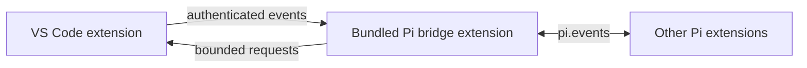

# Pi for VS Code

Use your existing [Pi](https://pi.dev) providers, models, and tools in VS Code. Work in a persistent sidebar or native `@pi` chat, attach editor context, and preview proposed edits before applying them.

[Install](#install) · [Get started](#get-started) · [Workflows](#focused-workflows) · [Settings](#settings) · [Security](#security-and-limits) · [Development](#development)

## Highlights

- **Rich responses** — Read Markdown tables, task lists, highlighted code, LaTeX math, and Mermaid flowcharts or sequence diagrams in the panel. Rendering uses bundled assets without a CDN.
- **Persistent sessions** — Browse, search, and switch recent workspace sessions, then rename, compact, export, delete, or hand them off to a terminal.
- **Editor-aware context** — Attach selections, files, diagnostics, language-provider definitions/references/call hierarchy/symbols, terminal text, and images. Inspect, redact, refresh, or pin a snapshot before sending it.
- **Review-first edits** — Preview a complete proposal or selected hunks, then apply the reviewed result with one workspace edit.
- **Focused workflows** — Review Git changes in four scopes, repair workspace diagnostics across files, import isolated worktree results, repair failed tests, restore request checkpoints, and inspect paused Node.js debug values.
- **Pi ecosystem support** — Keep using your Pi providers, models, thinking levels, prompt templates, skills, extensions, and contributed tools.
- **VS Code integration** — Fix diagnostics, rewrite selections, generate tests, request inline completions, and predict the next edit.

See the [feature matrix](docs/FEATURE_MATRIX.md) for the complete capability map.

## Requirements

- VS Code 1.106 or newer
- [Pi](https://pi.dev), installed and authenticated

Confirm that Pi is available in the environment where VS Code runs the extension:

```bash
pi --version
```

## Install

If you have `narumi.pi-coding-agent-vscode` installed, follow [Upgrade from the old extension ID](#upgrade-from-the-old-extension-id) first.

Ensure that `curl`, a POSIX shell, and the VS Code `code` command are available. Then install the latest release:

```bash
curl -fsSL https://raw.githubusercontent.com/narumiruna/pi-vscode/main/scripts/install.sh -o install-pi-vscode.sh &&
sh install-pi-vscode.sh &&
rm install-pi-vscode.sh
```

Review [`scripts/install.sh`](scripts/install.sh) before running downloaded code. The command stops if the download fails. The installer downloads `pi.vsix`, installs it with `code --install-extension`, and removes only the legacy global bridge files created by older releases. Extension activation performs the same cleanup for direct VSIX and Marketplace upgrades before starting Pi. New installations do not create files under `~/.pi/agent`.

For manual installation, download `pi.vsix` from [GitHub Releases](https://github.com/narumiruna/pi-vscode/releases) and use **Extensions: Install from VSIX…**.

To install a specific version, pass it to the downloaded script, for example `sh install-pi-vscode.sh 0.0.2`.

After installation or an update, run **Developer: Reload Window**. Sidebar sessions and **More… → Open in Terminal** load the bundled bridge automatically. See [Extension bridge](#extension-bridge) to use its tools in an ordinary integrated terminal.

## Get started

1. Run **Pi: Open Sessions** from the Command Palette, or open **Pi** in the Secondary Sidebar. Choose a session from **Sessions**, or use **View all** to search the current workspace. Sending from the Sessions-level composer starts a new session; **Back to Sessions** returns there from a conversation.
2. Choose **Attach** to add code, files, or images, or paste a supported image with Ctrl/Cmd+V.
3. Enter a request. The active model and thinking level appear beside **Send**.
4. For proposed changes, choose **Preview**, optionally select hunks, and then choose **Apply**.
5. Open **More…** for session management, export, terminal handoff, staged review, repair tools, checkpoints, and background or worktree agents.

Use `@pi` in VS Code's native Chat view when you prefer the native participant workflow. Native Chat history is separate from the Pi sidebar session.

### Editor actions

| Action | Shortcut or location |
| --- | --- |
| Fix a diagnostic or open inline edit | **Ctrl/Cmd+I** |
| Request an inline completion | **Alt+]** |
| Suggest the next edit | **Ctrl+Alt+N** / **Cmd+Alt+N** on macOS |
| Ask about or modify a selection | Editor lightbulb → **Rewrite**, or editor context menu → **Pi** |

Automatic inline completions are disabled by default. Enable `picode.inlineCompletions.enabled` to request them after a typing pause.

## Upgrade from the old extension ID

The extension ID changed from `narumi.pi-coding-agent-vscode` to `narumi.narumi-pi`. VS Code treats them as separate extensions. Do not keep both installed. The release installer and `npm run install:extension` stop if the old ID is installed. Follow these steps before using either installer, installing a VSIX manually, or installing from Marketplace:

1. In the old extension, stop active requests and background agents. Export any conversation you need. Review and save worktree results outside extension storage. Record worktree paths and commit or copy any changes you need.
2. Remove the old extension from the same VS Code profile and extension host where you will install the new one:

   ```bash
   code --uninstall-extension narumi.pi-coding-agent-vscode
   ```

   For a named profile, use `--profile "<profile>"`. In a Remote SSH, WSL, or container window, remove the old extension from that remote host through the Extensions view.
3. Run **Developer: Reload Window**. Install the new extension, then reload again.
4. Open **Pi: Open Sessions** and select a persistent Pi session for the current workspace.

The installers do not copy or delete VS Code state. The old sidebar cache, last-session pointer, and background-task records do not transfer to the new ID. Worktrees under the old extension's global storage do not transfer. Save their results before removal. Pi session files remain separate from VS Code extension state and can be selected from the new extension. Existing `picode.*` settings keep their names.

## Focused workflows

| Workflow | How it works |
| --- | --- |
| **Staged review** | Run **Pi: Review Staged Changes**, confirm the bounded snapshot, then use **Pi: Show Staged Findings** to navigate immutable before/after content. Findings become stale when HEAD or the index changes. |
| **Change review** | Run **Pi: Review Changes**, choose staged, unstaged (including untracked), all working-tree changes, or current branch versus a selected local/remote base ref. **Pi: Show Review Findings** navigates the latest captured result. No fetch or hosted PR access is performed. |
| **Review findings** | Problems entries open immutable captured text, labelled with scope/time. The Problems row's Quick Fix/lightbulb menu offers **Ask Pi About Finding** and, only for an exact writable after-image match, **Fix Finding with Pi (Preview)**. Stale actions require a new review; Problems are not live diagnostics. |
| **Workspace diagnostic repair** | Run **Pi: Fix Workspace Diagnostics (Preview)**, select errors/warnings in one workspace, inspect the complete captured files, and confirm transmission. Choose hunks, preview every selected file, then apply once. Diagnostic updates are observations, not test results. |
| **Semantic context** | Choose **Attach → Definition / References / Callers / Callees / Document Symbols** at the active cursor. Inspect/redact or pin the captured context before sending; attach again for a fresh provider lookup. Missing providers produce a notice, not guessed results. |
| **Selected edits** | On a proposal card, choose **Choose Hunks → Preview → Apply**. Changing the selection invalidates the preview; normal editor Undo remains available after application. |
| **Worktree result import** | Start an isolated agent from **More…**. When it becomes inactive, choose **Review Results → Apply Selected** to import reviewed text files into the originating worktree. |
| **Attachment inspection** | Choose **View attachments** in the composer to inspect the exact snapshot, redact or edit it, refresh it explicitly, or pin it for later requests. |
| **Failed-test repair** | Run **Pi: Repair Failed Test (Preview)**, approve a command or provide an existing UTF-8 log, inspect the evidence, then preview and apply the repair. |
| **Request checkpoints** | Choose **More… → Request Checkpoints** to inspect coverage, preview a restore, and revert covered changes. Checkpoints are memory-only file recovery, not a Git or conversation rewind. |
| **Slash commands** | Type `/` in the composer to list Pi extension commands, prompt templates, skills, and `/compact`. Type `/com` to find command names that contain `com`. Use Up/Down to select, Enter or Tab to complete, then Enter to run. Click to complete or press Escape to close. `/compact` accepts optional instructions and acts on the current session. Remove attachments before running commands. TUI-only commands are not listed. |
| **In-flight instructions** | While a request is running, press Enter to send **Next** after the current tool finishes. Use Alt+Enter on macOS and Linux, or Ctrl+Q on Windows (including remote WSL sessions), to send **After this** when Pi finishes responding. Pending text stays visible under these labels, then moves into the transcript as soon as Pi starts that user message. |
| **Debug questions** | Pause a Node.js debugger and run **Pi: Ask Debug Context**. Approve capture, choose local variables, inspect or redact the snapshot, and ask a read-only question. |

Process-launching and mutation workflows require a trusted, file-backed workspace. A Pi session's working directory must match the active workspace. Open an isolated worktree in its own VS Code window before resuming its session.

## Panel content

The session panel supports Markdown headings, nested lists, task lists, tables, quotes, links, emphasis, and strikethrough. Code highlighting covers Bash, CSS, JavaScript, JSON, Python, TypeScript, and HTML/XML, including their registered aliases. Other languages stay plain text.

Math uses KaTeX with `$…$`, `$$…$$`, `\(...\)`, and `\[...\]`. This is math rendering, not full TeX document support. Currency text such as `$5 and $10`, shell-variable expressions such as `$PATH:$HOME`, and code are not treated as math. Invalid or incomplete formulas remain readable source. Each message can render up to 50 formulas of 4,000 characters each, with at most 200 macro expansions and a 10em KaTeX size limit.

Complete `mermaid` code fences can render flowcharts (`flowchart` or `graph`) and sequence diagrams. Source stays visible below the diagram. Other diagram types, invalid diagrams, configuration directives, custom CSS, HTML labels, images, links, and callbacks stay source-only. Diagrams are limited to 8,000 characters and 120 lines; flowcharts also have a 100-edge limit. At most 100 diagrams can wait for rendering. Oversized or failed content does not prevent the rest of the response from displaying.

Links permit only HTTP, HTTPS, and email targets. Raw HTML and Markdown images are not enabled; use image attachments instead. Tables, code, and display math scroll horizontally when necessary. Native `@pi` chat and Pi HTML exports retain their own renderers.

## Settings

| Setting | Default | Purpose |
| --- | --- | --- |
| `picode.executablePath` | `pi` | Pi executable name or absolute path. |
| `picode.provider` | Empty | Optional provider override; empty uses Pi settings. |
| `picode.model` | Empty | Optional model override; empty uses Pi settings. |
| `picode.thinkingLevel` | `default` | Optional thinking-level override. |
| `picode.agent.confirmToolCalls` | `dangerous` | Approval policy for Pi's built-in `bash`, `edit`, and `write` tools. |
| `picode.approveProjectResources` | `false` | Allow trusted project-local Pi settings, extensions, skills, and prompts. |
| `picode.sensitiveContextNames` | Sensitive filename fragments | Add best-effort warnings to matching attachment labels. |
| `picode.inlineCompletions.enabled` | `false` | Enable automatic inline completions. |

Additional settings control inline-completion delay, minimum prefix length, and excluded languages.

## Security and limits

Pi sidebar sessions expose Pi's default coding tools and tools contributed by installed Pi extensions. The packaged confirmation policy covers only Pi's built-in `bash`, `edit`, and `write` tools; contributed tools define their own permission behavior.

Focused edit workflows use a packaged read-only policy while generating proposals. Applying edits, importing worktree results, rerunning tests, and restoring checkpoints always require explicit user action. Project-local Pi resources remain disabled until the workspace is trusted and `picode.approveProjectResources` is enabled.

Prompts and approved context are sent to Pi through standard input, not command-line arguments. The selected provider receives that content under its own data policy. Transcript state stores image metadata, but not Base64 image payloads.

Key operational limits:

- Attachments allow 8 items and 400,000 total text characters, including up to 5 images of 5 MiB each.
- Each Git review supports up to 100 text files, 100 KB per side, 400 KB of retained text, a 200 KB diff, and a 45-second capture deadline. Unsupported files remain explicitly not reviewed. Up to eight captured reviews are held in memory, replaced per repository/scope.
- Semantic lookups return at most 50 locations with a five-second provider deadline. Attachments include at most 20 excerpts of 4,000 characters each, within the existing attachment limits. Language providers can activate third-party extensions and require workspace trust.
- Workspace diagnostic repair selects at most 100 errors/warnings in 20 files, 100,000 characters per file and 400,000 serialized characters per request/response. Existing dirty buffers are included; other document text must match safely captured disk bytes. Unknown paths, symlinks, stale/read-only targets and unverifiable text encodings are rejected. One workspace edit supports native Undo.
- Failed-test repair accepts an executable and argument array, not a shell expression. Runs stop after 60 seconds, output is capped at 256 KiB, and repair is limited to two attempts. Apply asks for save/rerun approval and revalidates the source before changing its buffer; cancellation or rejected workspace aliases leave no repair to save later.
- Checkpoints keep up to 20 requests in memory and restore only deterministically observed edits to captured regular text files.
- In-flight instructions are limited to 10 messages and 50,000 characters. **Next** and **After this** messages can include captured text attachments and up to 5 images; slash commands cannot be queued. Pending transcript presentation is memory-only, public pending previews are capped at 1,000 characters per message, and pending/recovered attachment snapshots are memory-only and capped at 30 MiB.
- Debug capture supports paused `node` and `pwa-node` js-debug sessions only; it does not evaluate expressions or mutate debugger state.

Read [Security and Privacy](docs/SECURITY.md) for trust boundaries and safeguards. [Workflow Validation](docs/WORKFLOW_VALIDATION.md) records historical validation evidence and deferred checks; it is not the source for current commands.

## Extension bridge

The Pi bridge extension bundled in the VSIX and the VS Code extension communicate over an authenticated local bridge:



The bridge provides `vscode_context`, `vscode_code_context`, `vscode_open_file`, and `vscode_notify` for sidebar sessions and **Open in Terminal** handoffs.

A new ordinary integrated terminal inherits the authenticated bridge environment and bridge path, but plain `pi` does not load the bridge. Load it explicitly when you need these tools:

```bash
pi --extension "$PICODE_BRIDGE_EXTENSION"
```

In PowerShell, use `pi --extension $env:PICODE_BRIDGE_EXTENSION`.

Other Pi extensions can use `pi.events` to send an allowlisted `vscode:request` and receive a correlated `vscode:response` or `vscode:event`.

`vscode_code_context` accepts `definition`, `references`, `callers`, `callees`, or `documentSymbols`, a workspace path and optional one-based line/column. It returns metadata only, with zero-based ranges; source text requires a separate read. The tool is not loaded by independent background/worktree agents.

VS Code extensions in the same Extension Host can activate `narumi.narumi-pi` and call its exported `broadcast(event, data)` API. Event names and payloads are validated and bounded.

## Install from source

Building from source requires Node.js 22.19 or newer, npm, and a POSIX shell available as `sh`. On Windows, install Git for Windows and add its `sh` command to `PATH`.

```bash
npm ci
npm run install:extension
```

`npm run install:extension` packages and installs the VS Code extension, then removes the exact legacy global bridge filenames created by older releases. It does not install a Pi extension under `${PI_CODING_AGENT_DIR:-~/.pi/agent}`. The extension ID is `narumi.narumi-pi`.

Use `npm run install:vsix` to package and install without the legacy global bridge cleanup. `npm ci` installs the locked project dependencies; it does not install the VS Code extension.

Run **Developer: Reload Window** after installation. Use **More… → Open in Terminal** for an automatically bridged Pi session. For an ordinary integrated terminal, see [Extension bridge](#extension-bridge).

## Development

Use Node.js 22.19 or newer and install the locked dependencies:

```bash
npm ci
npm test
npm exec --yes --package=@biomejs/biome@2.5.13 -- biome check src resources
```

### Build and package

| Command | Purpose |
| --- | --- |
| `npm run compile` | Check host and browser TypeScript; build bundled renderer JS, CSS, and fonts. |
| `npm run watch` | Watch host TypeScript only. Rerun `compile` after renderer or style changes. |
| `npm test` | Compile, then run the Vitest suite without a live model. |
| `npm run package` | Run the full test suite and create or overwrite `pi.vsix`. |

### Browser checks

Install local Playwright Chromium before running browser checks:

```bash
npm exec -- playwright-core install chromium
npm run test:rich-content
npm run test:thinking-picker
```

The rich-content check tests the sidebar document, CSP, rendering, themes, overflow, and asynchronous lifecycle. Run it after renderer changes. Run the thinking-picker check after thinking-picker changes. Neither uses a live model.

### Native VS Code checks

| Command | Purpose |
| --- | --- |
| `npm run test:native -- 1.106.0` | Isolated Extension Host assertions against the minimum supported VS Code version. |
| `xvfb-run -a npm run test:native-ui -- 1.106.0` | Linux UI checks for attachments, review confirmations, Problems actions, proposals, multi-file Apply/Undo, and reload. |

On headless Linux, also prefix `test:native` with `xvfb-run -a`. Replace `1.106.0` with `stable` to check the current VS Code release.

1. Append `untrusted` to the `test:native` command for Restricted Mode.
2. Append `alias` to the `test:native-ui` command to test a workspace opened through a directory symlink.
3. Append `packaged` to the `test:native-ui` command to install and test the local `pi.vsix`.

Native checks download a VS Code test build into the system temporary cache and use disposable profiles and workspaces. UI checks use a deterministic Pi RPC fixture; Playwright connects only to the disposable profile's loopback debugging endpoint. These checks do not use a live model, your VS Code profile, or your workspace.

### Local installation and debugging

These commands run local processes or change the installed extension; they are not isolated checks:

- `npm run dev` rebuilds and installs the extension, removes legacy bridge files, then opens the current directory in a new VS Code window.
- `npm run dev:pi` starts Pi with `resources/picode-bridge.ts` in the current terminal.

## Release

1. Add a repository Actions secret named `PAT_TOKEN`. Use a fine-grained personal access token with **Contents: Read and write** and **Pull requests: Read and write** access to this repository.
2. Add a repository Actions secret named `VSCE_PAT`. Use an Azure Personal Access Token with **Marketplace (Manage)** scope and access to publisher `narumi`.
3. For each release-worthy pull request, run `npm run changeset` and commit the generated `.changeset/*.md` file.
4. Merge the pull request into `main`. The [Publish workflow](.github/workflows/publish.yml) creates or updates a Version PR when pending changesets exist.
5. Review and merge the Version PR to publish the release.

The workflow runs on each push to `main`. The Version PR applies pending changesets, updates `CHANGELOG.md`, `package.json`, and `package-lock.json`, and removes the consumed changesets. A push without a version change only checks for a Version PR; it does not publish a release. When the Version PR merges, the workflow checks the version and lockfile, checks that no changesets remain, runs the tests, and packages and verifies the VSIX. The `release` job creates a `v<version>` GitHub release with `pi.vsix` attached. `PAT_TOKEN` authenticates Version PR updates and GitHub release creation. The `publish` job then uses `VSCE_PAT` to publish the same verified VSIX artifact to Visual Studio Marketplace without rebuilding it.

If Marketplace publication fails, the GitHub release remains available. Use **Re-run failed jobs** on the same workflow run to retry `publish` without repeating version updates or release creation. The VSIX artifact must still be available in that run.

## License

[MIT](LICENSE)
