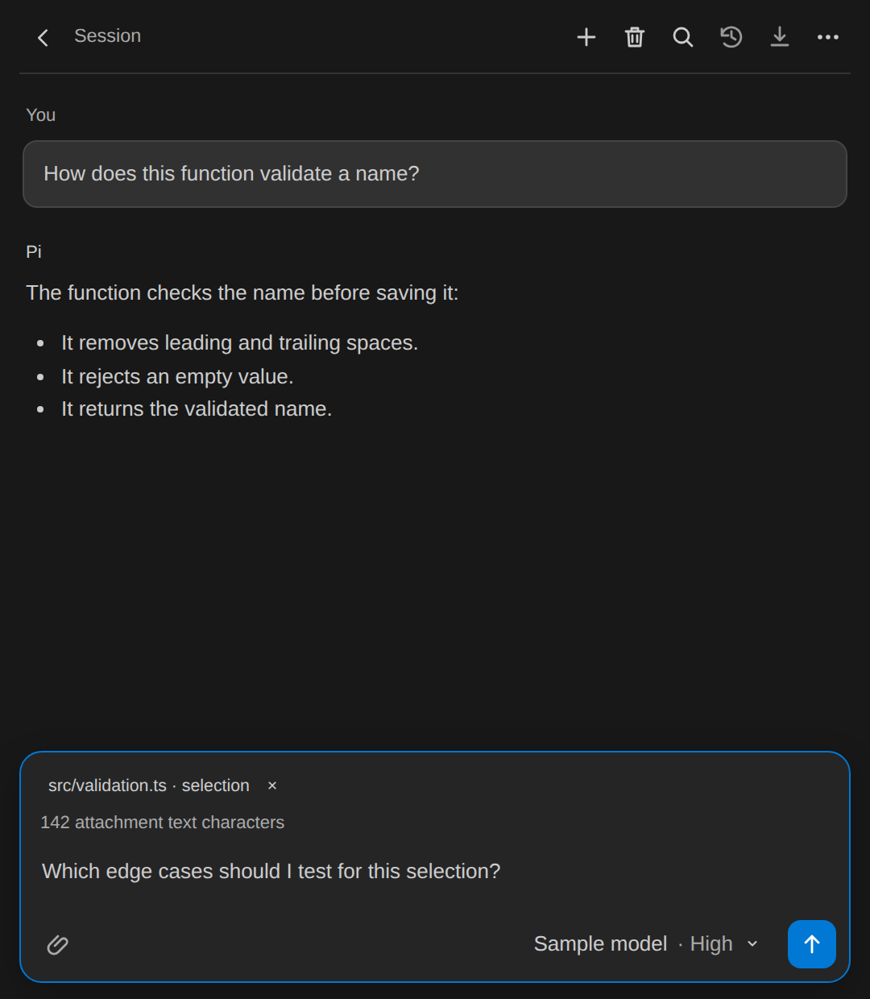
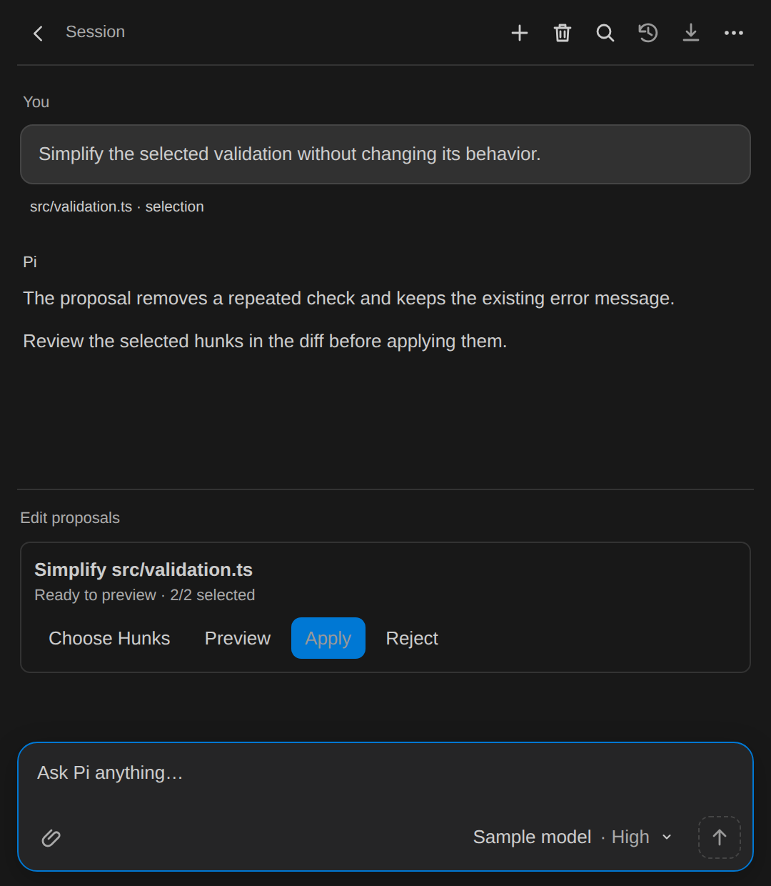

# Pi for VS Code

Use your existing [Pi](https://pi.dev) providers, models, and tools in VS Code.
Ask about code in concurrent Sidebar conversations, independent editor sessions, or native `@pi` chat.
Attach editor context, review Git changes, and use focused edit workflows with Preview and Apply.

**Permission boundary:** Focused edit workflows generate proposals under a read-only policy and require explicit Apply. Ordinary agent sessions can run tools and change files without Preview and Apply. Pi and installed extensions own tool and shell permissions; without a permission policy, actions can run with no confirmation.

[Install](#install) · [Get started](#get-started) · [Workflows](#focused-workflows) · [Settings](#settings) · [Security](#security-and-limits) · [Documentation](#documentation)

## See the workflow

### Attach context and ask



Choose **Attach**, inspect the captured context, and enter your question. The model control selects the model and thinking level.

### Review a focused edit



Run **Pi: Modify Selection (Preview)**, describe the change in the Sidebar composer, and choose **Send**.
Choose **Choose Hunks** if needed, then **Preview** to open the native diff editor.
**Apply** becomes available after preview; changing the hunk selection requires another preview.

Pi replies have a `Pi` heading with no icon.
These screenshots use the current sidebar renderer with offline sample data.
They do not show a live provider response or the native diff editor.

## Requirements

1. VS Code **1.146.0 or newer**, matching the pinned `@types/vscode` declarations.
2. A configured [Pi](https://pi.dev) provider for model requests.
3. A trusted, file-backed workspace for process-launching and mutation workflows.

The extension bundles **Pi 1.5.2** and uses it by default without a separate Pi or Node.js installation.
An unset, empty, or whitespace-only `pi.executablePath` selects bundled Pi.
Any nonempty value selects external Pi, including an explicitly saved `pi` command; existing overrides are not rewritten.
Reset removes only the selected scope's override, so another effective override can still select external Pi.
If the remembered session file is missing, Pi automatically starts a new session without a confirmation dialog.
A short Sidebar notice reports the recovery; existing session files remain unchanged.
Unsaved session paths are no longer kept for restore after reload.
History synchronization failures preserve existing session references and files, without automatic new-session fallback or request replay.

Pi runs as a subprocess on the workspace Extension Host, including in Remote SSH, WSL, and container windows.
Bundled Pi reuses that host's existing Pi configuration, credentials, resources, provider environment, and sessions without migration or separate user stores.
Configure providers on that host.
Extension releases own bundled runtime updates; ordinary terminals and external Pi installations remain unchanged.
Missing or invalid bundled assets fail without PATH fallback or automatic operation replay.
See [Runtime selection and recovery](docs/USER_GUIDE.md#runtime-selection-and-recovery) and [validation coverage](docs/BUNDLED_RUNTIME_VALIDATION.md) for compatibility limits and unverified targets.

| Capability | Pi compatibility |
| --- | --- |
| Sidebar chat and focused edit requests | Use Pi's public RPC interface with bundled **1.5.2** by default; no broader external version range is verified. |
| **Pi: Sign In to Provider** / **Pi: Sign Out of Provider** | The isolated helper accepts exactly **1.3.0 or 1.5.2**, not a version range. Other versions must use Pi's own authentication flow. |
| JSONL session export, import, and GitHub sharing | The isolated helper accepts exactly **1.3.0 or 1.5.2**. JSONL export covers the active branch, not the complete tree. |
| Direct shell (`!` / `!!`) | Accepts exactly **1.3.0 or 1.5.2** through canonical packaged read-only sentinel version metadata. Other versions leave this feature unavailable. |
| Resource reload and session-tree controls | Require verified packaged-command ownership metadata, checked through **1.5.2** extracted-runtime smoke and retained earlier **1.3.0** evidence. Unsupported routes fail without sending a model prompt. |

External Pi on Windows supports native executables and standard npm Node shims, not custom batch wrappers.
See [Windows process launches](docs/USER_GUIDE.md#windows-process-launches) for lookup and cleanup limits.

## Install

The extension ID is `narumi.narumi-pi`. If the old `narumi.pi-coding-agent-vscode` extension is installed, complete the [upgrade steps](#upgrade-from-the-old-extension-id) first.

1. Open [Pi on Visual Studio Marketplace](https://marketplace.visualstudio.com/items?itemName=narumi.narumi-pi) and choose **Install**, or find `narumi.narumi-pi` in VS Code's Extensions view.
2. Run **Developer: Reload Window** after installation or an update.

If the VS Code `code` command is available, you can install from a terminal instead:

```sh
code --install-extension narumi.narumi-pi
```

Marketplace installation does not require `curl` or a POSIX shell. For manual VSIX installation or the optional release script, see [installation alternatives](docs/USER_GUIDE.md#installation-alternatives).

## Get started

1. Open your project and run **Pi: Open Sessions** from the Command Palette. Choose a saved session, or send from the Sessions composer to start one.
2. Choose **Attach** to add a selection, file, diagnostics, or image. Inspect or redact snapshots through **Attach → View attachments**. Choose your model and thinking level from the composer model control.
3. Enter a request and send it.
   For a review-first change, select code, run **Pi: Modify Selection (Preview)**, describe the change, and choose **Send**.
   Review the proposal with **Preview**, then choose **Apply**.

When new messages arrive, the panel preserves text selection in messages that remain in the current window. Tool input/output **Copy** buttons use the VS Code clipboard. Pasting text with an image keeps both. After Enter, the draft stays until Pi accepts it; **Sending this message** shows this pending state. Rejected submissions keep the text, and acceptance does not clear a newer draft or move focus from the transcript.

Type `/` in either Sidebar composer for shortcuts, including before Pi connects.
Use `/new`, `/model`, `/thinking`, `/settings`, `/extension-settings`, `/resume`, and `/session` for existing controls.
Run `/skills` to search loaded skills, or `/commands` to search Pi extension commands, prompt templates, and skills.
These discovery commands connect to Pi if needed; selecting a resource inserts a draft without sending it.
Typing `/` alone does not start Pi.
See [slash commands](docs/USER_GUIDE.md#focused-workflows) for all shortcuts and keyboard controls.

Select editor text and choose **Pi → Ask About Selection**, the **Ask Pi** code action, or **Ctrl+Alt+A** (**Cmd+Alt+A** on macOS) to add an unsent reference above the Sidebar composer.
Add more selections, remove individual references, and describe what to discuss or change for each file/range before sending.
This targets the stable **Primary** Sidebar session and keeps its draft; it does not open a separate question input or send immediately.
Selecting an auxiliary Sidebar conversation or focusing an editor panel does not redirect editor actions.
The other selection-menu actions also prepare a labelled read-only action before **Send**, without replacing your text.
**Modify Selection (Preview)** needs a description; the other presets show their default request and accept extra details.
**Cancel** removes only the pending action, keeping references and text.
Prepared read-only actions wait for idle Pi instead of entering the ordinary queue; Preview actions still require **Preview** before **Apply**.

The Sessions list fills the available space above the composer and scrolls when needed, rather than showing only three entries.
Choose **View all** to search the discovered sessions in this workspace.
If an unnamed saved session starts with a skill, its title shows the `/skill:` command and any arguments instead of the expanded instructions.

Use **Pi: Switch Session** to search live and saved Sidebar sessions in the current workspace, or **Pi: Previous Session** / **Pi: Next Session** to cycle through them.
Default shortcuts use **Ctrl+K**, then **Ctrl+Alt+Shift+S / Left / Right**; on macOS use **Cmd+K**, then **Cmd+Alt+Shift+S / Left / Right**.
Native navigation shows the selected conversation, even if the Sidebar was hidden.
If an editor panel owns the session, navigation focuses that panel and cycling continues from its position.
Cycling keeps its order while sessions are updated.
Selecting another conversation does not stop active requests, queues, or source-bound input dialogs.
Actual RPC session mutations and exclusive workspace actions retain their existing idle and ownership gates.
See [session switching](docs/USER_GUIDE.md#switch-sessions) for discovery limits and recovery behavior.

Use `@pi` in VS Code's native Chat view if you prefer that interface.
Native Chat history is separate from sidebar sessions.
The sidebar's **More…** provides session management, terminal handoff, repair tools, checkpoints, and background agents.
See the [user guide](docs/USER_GUIDE.md#get-started) for controls and shortcuts.

### Concurrent Sidebar sessions

Start work in A, return to **Sessions**, and select live B, open a saved B, or create a new conversation while A continues.
**View all**, **Pi: Switch Session**, **Previous/Next Session**, **New Session**, and **Resume Session** use the same Sidebar selection.
Each conversation retains its transcript, draft, attachments, queue, model/thinking selection, and **Stop**.
Cancelled or rejected selection leaves session rows usable; selecting an editor-owned session can reveal its panel without locking Sidebar navigation.
Selecting a retained conversation or recreating its renderer resends referenced image payloads from the bounded host cache.
Native session navigation can initialize Primary when the Sidebar has not opened yet.
Local `/new` and `/resume` can navigate during work without entering the model queue; attachment and prepared-action guards still apply.
If an actual runtime replacement changes the session behind a nonempty draft, verify the session and clear the kept text before sending.
That context block stays with its entry across selection and renderer recreation.
Accepted text is cleared even while the Sidebar renderer is closed; newer or context-blocked drafts stay intact.
Late composer reports cannot make old text sendable in a replacement session.
Local `/settings`, `/extension-settings`, and `/session` commands do not allocate a conversation.
Opening Sessions alone preserves Primary checkpoints; admitted shared sessions still activate concurrent-safety checks.
Native input and approval dialogs identify their source conversation; changing the displayed conversation does not answer or transfer them.

A status icon appears before each title in Recent Sessions and View all.
The green **Running** ring rotates unless reduced motion is enabled.
Hover over a row to see the status name, or use a screen reader to hear it.
See the [status icon legend](docs/USER_GUIDE.md#concurrent-sidebar-sessions) for all six states.
An **Unread result** marker clears only after that result is rendered in visible conversation detail while following the latest output.
Row selection alone, Sessions view, a hidden Sidebar, or earlier history does not acknowledge it.
History loading must finish, and a shell result must be in the published transcript before its result revision can be acknowledged.
Completed means the request settled, not that its answer or file changes are correct.

One fixed pool permits **one Primary plus eight additional runtimes in total across Sidebar conversations and editor panels**.
Retained idle conversations and cleanup-quarantined sessions count toward the additional eight.
Opening an additional Sidebar session requires the shared-file warning's explicit **Open Session** confirmation.
Use **Close Session** on an auxiliary Sidebar conversation to stop only its work and discard its unsent memory-only state after confirmation, without deleting saved Pi history.
Hiding the Sidebar does not close conversations.

**Primary** labels the stable window-service owner, not the selected or busiest conversation.
Terminal handoff/recovery, restart, annotations, editor actions, review/repair, settings, authentication, and public bridge broadcast stay Primary-owned.
Auxiliary conversations support ordinary conversation controls, but omit or reject privileged routes like editor sessions.
Selection or panel focus never silently redirects global commands.
Sessions share files without worktree isolation.
Activity, unread state, auxiliary transcripts, and auxiliary restore references are memory-only; reload does not restart auxiliary work or replay queues.
Optional draft recovery keeps its existing consent and shared limits, without additional persistent transcript keys.
See [concurrent Sidebar sessions](docs/USER_GUIDE.md#concurrent-sidebar-sessions) and [current validation](docs/FEATURE_MATRIX.md#concurrent-sidebar-sessions).
Offline unit, browser, and VS Code 1.146.0 native checks passed; platform, remote, and screen-reader limits remain in the linked validation.

### Concurrent editor sessions

Run **Pi: New Concurrent Session** (`pi.newConcurrentSession`) or choose **+** in the Pi view title to open an independent native editor panel.
Confirm the shared-file warning before opening each session.
Editor panels share the eight additional runtime slots with auxiliary Sidebar conversations; they do not receive a separate allowance.
Each has its own Pi RPC process, transcript, composer draft, attachments, queue, model/thinking controls, and Stop.
Panels keep the opened workspace URI, including a workspace-root alias, and reconnect to that workspace rather than the active editor's workspace.
Startup, reconnect, and new ordinary requests fail if the original folder is removed or its canonical root changes.
Hiding a panel or switching tabs keeps its work running.
Closing it stops only its runtime and retains saved Pi session files.
A normal close frees its slot after all bounded cleanup completes; unverified cleanup keeps the slot and session-file claim blocked until window reload.
Unverified RPC cleanup also blocks exclusive workspace actions, including Apply and checkpoint restore, until window reload.
Ordinary concurrent requests remain available, but their checkpoint attribution is unverified.
Inspect and stop residual processes before reloading; requests are not retried automatically.
Queued instructions with equal text keep distinct recovery drafts and attachment snapshots, within the existing recovery limits.

Sessions share workspace files and existing Pi credentials, configuration, and storage; they are not isolated or sandboxed.
Sidebar navigation commands select conversations through Sessions; editor-panel focus does not redirect them.
Other existing global integrations, including editor actions, review, and repair, target **Primary**.
Terminal handoff/recovery, confirmed restart, and temporary annotations remain Primary-only and are omitted from auxiliary routes.
Ordinary requests can overlap, but direct shell, session/resource controls, Apply, import, and checkpoint restore keep their exclusive workspace gates.
Concurrent activity can make checkpoint restoration unavailable.
If you select **Stop** while Pi prepares the workspace checkpoint, the extension cancels the request before it sends the prompt.

Editor panels do not automatically restore or restart after window reload.
After a panel closes and writer cleanup is verified, resume its saved session through the sidebar.
Auxiliary Sidebar and panel transcript caches and restore references stay in memory; optional text draft recovery uses the shared consent-gated store and existing limits.
A late send acknowledgement cannot remove a newer retained draft written by another view, even when its text is the same.
See [concurrent editor sessions](docs/USER_GUIDE.md#concurrent-editor-sessions) for writer-ownership and recovery limits.
Earlier editor-session validation recorded offline host and Chromium checks and a focused macOS VS Code 1.146.0 native check for two editor sessions and independent Stop.
Those results do not establish final verification of Sidebar concurrency or the shared pool.
Remote, other platforms, reload, and live-provider limits remain separate.
See the [validation coverage](docs/FEATURE_MATRIX.md#concurrent-interactive-editor-sessions).

## Focused workflows

| Task | Entry point |
| --- | --- |
| Review Git changes | **Pi: Review Changes**; choose staged, unstaged, working-tree, or branch scope. Open captured findings with **Pi: Show Review Findings**. |
| Review staged changes | **Pi: Review Staged Changes**, then **Pi: Show Staged Findings**. |
| Repair diagnostics | **Pi: Fix Workspace Diagnostics (Preview)**. |
| Repair a failed test | **Pi: Repair Failed Test (Preview)**; approve a command or inspect an existing log. |
| Ask about paused debug values | **Pi: Ask Debug Context**; supports paused Node.js debug sessions. |
| Import isolated-agent results | **More… → Review Results → Apply Selected** on an inactive worktree agent. |
| Inspect or restore request checkpoints | **More… → Request Checkpoints**; memory-only file recovery, not a Git rewind. |

See [workflow instructions and limits](docs/USER_GUIDE.md#focused-workflows) and the [feature matrix](docs/FEATURE_MATRIX.md).
Responses support Markdown, highlighted code, math, and supported Mermaid diagrams with bundled rendering assets.
Tool calls appear in conversation order between responses, each collapsed by default.
Expand a call to inspect its input, output, and status.
History navigation keeps responses accessible when tool calls reach a window limit.

The **Primary** Sidebar agent can add [temporary passage annotations](docs/USER_GUIDE.md#temporary-passage-annotations): whole-line highlights, literal hovers and read-only native comments below the marked code or text. Comments start collapsed by default. Set `pi.annotations.initialState` to `expanded` in **VS Code Settings → Pi → Editor → Annotation initial state** to expand newly created or replaced annotations; existing threads and user state on redraw are unchanged. VS Code may open the Comments panel and change editor layout or scroll position; source files remain unchanged. Use **Pi: Clear Annotations** to remove them.

## Settings

In the Pi view title's native **⋯** overflow menu, **Extension Settings** and **Pi Configuration** appear directly in the same configuration group, in that order.
There is no standalone settings gear or settings submenu.
Composer **More…** remains for session and work actions; it has no duplicate entries for these commands.
Run **Pi: Extension Settings** (`pi.openSettings`) or select **Extension Settings** in that menu to open native VS Code Settings filtered to `@ext:narumi.narumi-pi`.
**General**, **Permissions**, and **Editor** group the existing 11 `pi.*` settings without changing their IDs, defaults, bounds, scopes, or runtime behavior.
Use native scope selection, validation, save-on-edit, search, configured-value indicators, and Reset menus.

Run **Pi: Pi Configuration** (`pi.openPiConfiguration`) or select **Pi Configuration** in the same overflow menu to open the separate **Pi Configuration** panel.
Repeated invocation reveals the same panel.
Use **Save to** to select **Global Pi** or **Project Pi**; Project Pi identifies the first workspace folder's `.pi` directory.
There is no User/Workspace selector; one **Open Extension Settings** action opens extension settings.
Three sections group the controls: **Model** (manual **Provider ID**, **Model ID**, thinking level, ordered model patterns), **Behavior** (steering, follow-up, compaction, retry), and **MCP**.
No model catalog is fetched or offered by this page.
An inherited row shows a read-only value and one source label: **Inherited from Global** or **Pi default**.
**Set global override** or **Set project override** opens a local draft initialized from that value without writing a file.
Saved overrides remain editable; **Save** stays visible in editable rows and is disabled without a draft, while pending, or when stale.
Checkboxes and selects remain drafts until explicitly saved; an override equal to the inherited value is valid.
**Discard changes** removes only the local draft.
The row menu has **Remove global override** or **Remove project override** to remove the saved selected-scope member, and **Reload row** for recovery.
Stale drafts also show an inline **Reload row** action.
Secondary **Reload saved values** preserves unrelated drafts and does not reload Pi resources.
There is no Save All or Reset All.
Configured MCP servers expose safe metadata and inline enabled/exposure edits and resets, not transport or credentials; connection state remains **unknown**.
The secondary **Advanced** menu opens **Open Pi settings dialog…** or **Manage MCP servers…** for existing native management interfaces, including server creation, transport editing, authentication, diagnostics, and advanced editing.
**Pi: Open Native Pi Settings** (`pi.openNativeSettings`) and **Pi: Manage Native MCP Configuration** (`pi.openNativeMcp`) keep their existing command IDs and dialog behavior.

Global Pi uses the Extension Host's `~/.pi/agent` or `PI_CODING_AGENT_DIR`.
Project Pi uses the launch workspace's `.pi` (the first workspace folder, not a multi-root selector).
Native controls require a trusted, file-backed workspace.
One warning identifies inactive Project overrides when project resources are not approved; inherited Global values are not marked inactive.
**Review project approval setting** only opens native `pi.approveProjectResources` Settings; it changes no approval, trust, or runtime state.
Opening, reading, switching scopes, entering edit mode, or discarding drafts never creates files.
The first explicit override save creates only the needed file and missing Pi directories; resetting an absent override creates nothing.
One shared explanation states that Save changes Pi files, not running sessions.
Saving does not apply runtime settings, restart Pi, approve project resources, or connect MCP servers.
The separate **Restart Pi…** action uses the existing confirmed restart and lifecycle checks.
Cancellation or failure retains saved files and drafts; failure reports runtime uncertainty rather than successful application.
Provider, model, thinking level, and executable overrides apply at process startup; resumed-session values and VS Code launch overrides can still take precedence.
Reconnect does not restart Pi.
The webview receives validated common-setting values, safe MCP metadata, opaque revision tokens, and a host-owned restart action token, not raw native files or MCP transport/authentication fields.
Full snapshots stay in Extension Host memory; native draft persistence contains only bounded validated common-setting drafts.
Restart feedback recovers after hide/reveal without repeating the action or storing its authority token.

1. `pi.executablePath` defaults to empty, which selects bundled Pi **1.5.2**.
   Set a nonempty command or path to use compatible external Pi on the workspace Extension Host.
   Opening Settings does not start or validate either runtime.
2. `pi.approveProjectResources` defaults to `false`.
   Enable it only for trusted project-local Pi resources.
3. `pi.inlineCompletions.enabled` defaults to `false`.
   Manual inline completion remains available.

See the [settings reference](docs/USER_GUIDE.md#settings) and [native Pi settings and MCP controls](docs/USER_GUIDE.md#native-pi-settings-and-mcp).

## Security and limits

Ordinary agent sessions are not a sandbox. Pi and installed extensions own tool and shell permissions; pi-vscode adds no built-in tool or shell confirmation policy. Without a permission policy, tools and commands can run with no confirmation. Pi-requested dialogs continue to be displayed unchanged.

Focused edit generation uses a read-only policy. Applying proposals, importing worktree results, rerunning tests, and restoring checkpoints require explicit user action. Preview checks do not protect unrelated ordinary-agent tool calls.

The selected provider receives prompts and approved context under its own data policy. Inspect attachments before sending; sensitive-filename warnings are best-effort. Stop or process exit does not prove that every detached descendant stopped. Inspect remaining work before repeating an uncertain command.

Short operation results and recovery instructions stay in the Sidebar. Choose **Show Output** on a diagnostic notice to open **Output → Pi** without taking editor focus. The shared log uses VS Code log levels and records safe technical categories, not conversation content or credentials. Use VS Code's built-in log-level controls for Debug/Trace command timing. VS Code log files can outlive the window; review them before sharing.

Persistent Pi RPC accepts single lines up to 64 MiB, increased from 5 MiB; larger frames are rejected with a fixed Sidebar notice and a safe Output category.
After a fatal transport failure, no new RPC command or dialog reply is written to that client, including during cleanup.
Public `get_messages` still returns the full active branch without pagination; the Sidebar retains at most 100 messages and 250,000 shared text/thinking characters.
Full-response decoding and synchronous JSON parsing can still increase memory use and pause the Extension Host.
Bridge frames remain limited to 1 MiB and one-shot Pi output to 5 MiB; attachment and session import/export limits are unchanged.

Read [Security and Privacy](docs/SECURITY.md) for trust and logging boundaries, and [operational limits](docs/USER_GUIDE.md#security-and-limits) for attachment, review, repair, and history bounds.

## Upgrade from the old extension ID

Do not keep both extension IDs installed. Stop old work and preserve sessions and worktree results before removing the old extension. Follow the [complete migration instructions](docs/USER_GUIDE.md#upgrade-from-the-old-extension-id), including settings and bridge identifier changes. Persistent Pi session files remain separate from VS Code extension state.

## Documentation

1. [User guide](docs/USER_GUIDE.md): conversation controls, session transfer, authentication, rendering, and operational limits.
2. [Extension bridge](docs/USER_GUIDE.md#extension-bridge): editor tools in sidebar sessions, concurrent editor sessions, and sidebar terminal handoffs.
3. [Pi terminology](docs/PI_TERMINOLOGY.md): Pi core and extension naming boundaries.
4. [Development and release](docs/DEVELOPMENT.md): source builds, tests, validation limits, and publishing.
5. [Issues](https://github.com/narumiruna/pi-vscode/issues): report defects and request changes.

## Development

See [Development and release](docs/DEVELOPMENT.md) for build, test, screenshot-capture, and release commands. No installation or publication is required to run the offline tests.

## License

[MIT](LICENSE)
