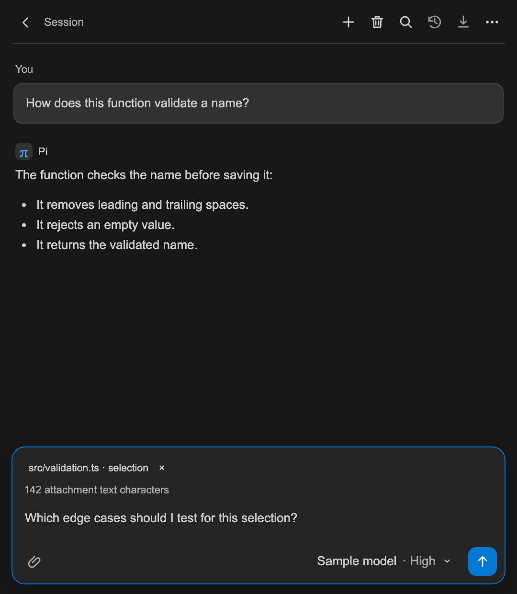
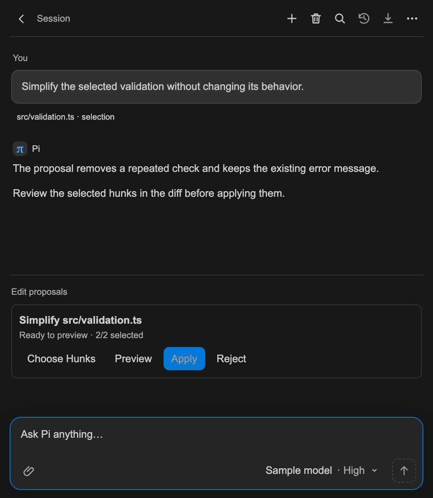

# Pi for VS Code

Use your existing [Pi](https://pi.dev) providers, models, and tools in VS Code. Ask about code in a persistent sidebar or native `@pi` chat. Attach editor context, review Git changes, and use focused edit workflows with Preview and Apply.

**Permission boundary:** Focused edit workflows generate proposals under a read-only policy and require explicit Apply. Ordinary agent sessions can run tools and change files without Preview and Apply. Pi and installed extensions own tool and shell permissions; without a permission policy, actions can run with no confirmation.

[Install](#install) · [Get started](#get-started) · [Workflows](#focused-workflows) · [Settings](#settings) · [Security](#security-and-limits) · [Documentation](#documentation)

## See the workflow

### Attach context and ask



Choose **Attach**, inspect the captured context, and enter your question. The model control selects the model and thinking level.

### Review a focused edit



Run **Pi: Modify Selection (Preview)** for a focused change. Choose **Choose Hunks** if needed, then **Preview** to open the native diff editor. **Apply** becomes available after preview; changing the hunk selection requires another preview.

These screenshots use the current sidebar renderer with offline sample data. They do not show a live provider response or the native diff editor.

## Requirements

1. VS Code **1.140 or newer**.
2. [Pi](https://pi.dev), installed in the environment where the extension runs, with a configured provider for model requests.
3. A trusted, file-backed workspace for process-launching and mutation workflows.

Check the Pi executable:

```bash
pi --version
```

In Remote SSH, WSL, or container windows, Pi runs on the remote Extension Host. Install and configure Pi there, not only on the local computer. Set `pi.executablePath` if VS Code cannot find it.

| Capability | Pi compatibility |
| --- | --- |
| Sidebar chat and focused edit requests | Use Pi's public RPC interface. Pi **1.3.0** is the checked reference; no broader version range is verified. |
| **Pi: Sign In to Provider** / **Pi: Sign Out of Provider** | The isolated helper accepts **1.3.0 only**. Other versions must use Pi's own authentication flow. |
| JSONL session export, import, and GitHub sharing | The isolated helper requires **1.3.0**. JSONL export covers the active branch, not the complete tree. |
| Direct shell (`!` / `!!`) | Requires **1.3.0** compatibility verified through read-only sentinel version metadata. Other versions leave this feature unavailable. |
| Resource reload and session-tree controls | Require verified packaged-command ownership metadata, checked against **1.3.0**. Unsupported routes fail without sending a model prompt. |

Windows supports native executables and standard npm Node shims, not custom batch wrappers. See [Windows process launches](docs/USER_GUIDE.md#windows-process-launches) for lookup and cleanup limits.

## Install

The extension ID is `narumi.narumi-pi`. If the old `narumi.pi-coding-agent-vscode` extension is installed, complete the [upgrade steps](#upgrade-from-the-old-extension-id) first.

1. Open [Pi on Visual Studio Marketplace](https://marketplace.visualstudio.com/items?itemName=narumi.narumi-pi) and choose **Install**, or find `narumi.narumi-pi` in VS Code's Extensions view.
2. Run **Developer: Reload Window** after installation or an update.

If the VS Code `code` command is available, you can install from a terminal instead:

```sh
code --install-extension narumi.narumi-pi
```

Marketplace installation does not require `curl` or a POSIX shell. For manual VSIX installation or the optional release script, see [installation alternatives](docs/USER_GUIDE.md#installation-alternatives).

## Get started

1. Open your project and run **Pi: Open Sessions** from the Command Palette. Choose a saved session, or send from the Sessions composer to start one.
2. Choose **Attach** to add a selection, file, diagnostics, or image. Inspect or redact snapshots through **Attach → View attachments**. Choose your model and thinking level from the composer model control.
3. Enter a request and send it. For a review-first change, select code and run **Pi: Modify Selection (Preview)**. Review the proposal with **Preview**, then choose **Apply**.

Use `@pi` in VS Code's native Chat view if you prefer that interface. Native Chat history is separate from sidebar sessions. **More…** provides session management, terminal handoff, repair tools, checkpoints, and background agents. See the [user guide](docs/USER_GUIDE.md#get-started) for controls and shortcuts.

## Focused workflows

| Task | Entry point |
| --- | --- |
| Review Git changes | **Pi: Review Changes**; choose staged, unstaged, working-tree, or branch scope. Open captured findings with **Pi: Show Review Findings**. |
| Review staged changes | **Pi: Review Staged Changes**, then **Pi: Show Staged Findings**. |
| Repair diagnostics | **Pi: Fix Workspace Diagnostics (Preview)**. |
| Repair a failed test | **Pi: Repair Failed Test (Preview)**; approve a command or inspect an existing log. |
| Ask about paused debug values | **Pi: Ask Debug Context**; supports paused Node.js debug sessions. |
| Import isolated-agent results | **More… → Review Results → Apply Selected** on an inactive worktree agent. |
| Inspect or restore request checkpoints | **More… → Request Checkpoints**; memory-only file recovery, not a Git rewind. |

See [workflow instructions and limits](docs/USER_GUIDE.md#focused-workflows) and the [feature matrix](docs/FEATURE_MATRIX.md). Responses support Markdown, highlighted code, math, and supported Mermaid diagrams with bundled rendering assets.

The foreground sidebar agent can add [temporary passage annotations](docs/USER_GUIDE.md#temporary-passage-annotations): whole-line highlights, literal hovers and read-only native comments below the marked code or text. Comments start collapsed by default. Set `pi.annotations.initialState` to `expanded` in **Pi Settings → Editor → Annotation initial state** to expand newly created or replaced annotations; existing threads and user state on redraw are unchanged. VS Code may open the Comments panel and change editor layout or scroll position; source files remain unchanged. Use **Pi: Clear Annotations** to remove them.

## Settings

Run **Pi: Open Settings** or use the gear in the Pi view title. **General**, **Permissions**, and **Editor** edit VS Code configuration at User or Workspace scope. **Pi Files** has **Global Pi** and **Project Pi** cards, each with **Edit … settings.json** and **Edit … mcp.json** buttons. These open existing host-native dialogs at the fixed card scope; native file content stays out of the webview. Command Palette native management remains available.

Global Pi uses the Extension Host's `~/.pi/agent` or `PI_CODING_AGENT_DIR`. Project Pi uses the launch workspace's `.pi` (the first workspace folder, not a multi-root selector). Native controls require a trusted, file-backed workspace. Opening, reading, or switching never creates files. The first explicit override save creates only the needed file and missing Pi directories; resetting an absent override creates nothing. Saving does not restart Pi, approve project resources, or connect MCP servers. Provider, model, thinking level, and executable overrides apply at process startup. Reconnect does not restart Pi.

1. `pi.approveProjectResources` defaults to `false`. Enable it only for trusted project-local Pi resources.
2. `pi.inlineCompletions.enabled` defaults to `false`. Manual inline completion remains available.

See the [settings reference](docs/USER_GUIDE.md#settings) and [native Pi settings and MCP controls](docs/USER_GUIDE.md#native-pi-settings-and-mcp).

## Security and limits

Ordinary agent sessions are not a sandbox. Pi and installed extensions own tool and shell permissions; pi-vscode adds no built-in tool or shell confirmation policy. Without a permission policy, tools and commands can run with no confirmation. Pi-requested dialogs continue to be displayed unchanged.

Focused edit generation uses a read-only policy. Applying proposals, importing worktree results, rerunning tests, and restoring checkpoints require explicit user action. Preview checks do not protect unrelated ordinary-agent tool calls.

The selected provider receives prompts and approved context under its own data policy. Inspect attachments before sending; sensitive-filename warnings are best-effort. Stop or process exit does not prove that every detached descendant stopped. Inspect remaining work before repeating an uncertain command.

Read [Security and Privacy](docs/SECURITY.md) for trust boundaries, and [operational limits](docs/USER_GUIDE.md#security-and-limits) for attachment, review, repair, and history bounds.

## Upgrade from the old extension ID

Do not keep both extension IDs installed. Stop old work and preserve sessions and worktree results before removing the old extension. Follow the [complete migration instructions](docs/USER_GUIDE.md#upgrade-from-the-old-extension-id), including settings and bridge identifier changes. Persistent Pi session files remain separate from VS Code extension state.

## Documentation

1. [User guide](docs/USER_GUIDE.md): conversation controls, session transfer, authentication, rendering, and operational limits.
2. [Extension bridge](docs/USER_GUIDE.md#extension-bridge): editor tools in sidebar sessions and terminal handoffs.
3. [Pi terminology](docs/PI_TERMINOLOGY.md): Pi core and extension naming boundaries.
4. [Development and release](docs/DEVELOPMENT.md): source builds, tests, validation limits, and publishing.
5. [Issues](https://github.com/narumiruna/pi-vscode/issues): report defects and request changes.

## Development

See [Development and release](docs/DEVELOPMENT.md) for build, test, screenshot-capture, and release commands. No installation or publication is required to run the offline tests.

## License

[MIT](LICENSE)
